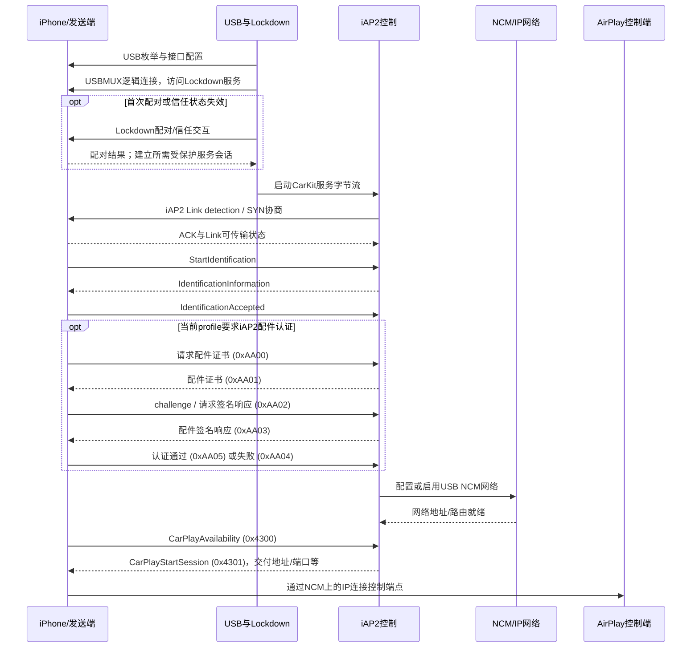
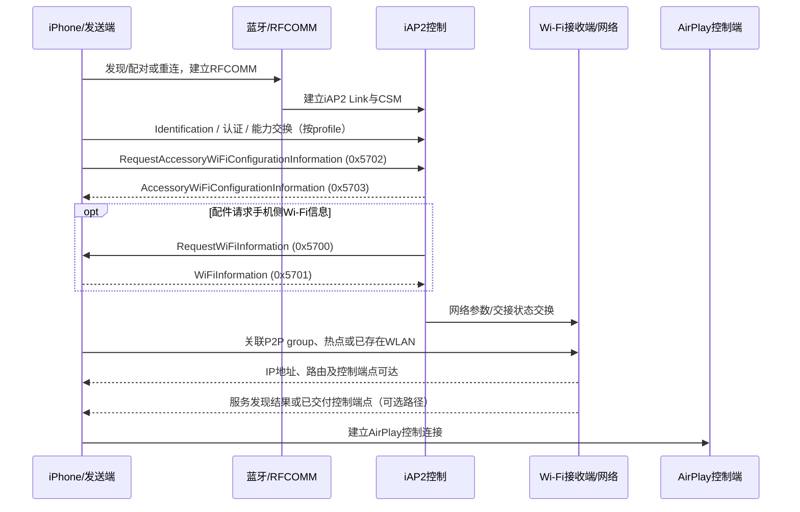
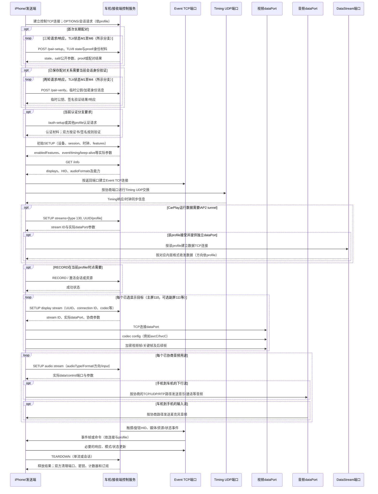

# Apple CarPlay 协议说明

> 范围：设备接入、iAP2 控制、网络发现、配对认证、RTSP 会话、音视频/数据通道、输入与车辆事件、生命周期。

## 目录与阅读路径

- **第一部分：范围与完整流程** — [1. 协议约定](#sec-01)、[2. 角色与分层](#sec-02)、[3. 完整交互流程](#sec-03)。
- **第二部分：接入与 iAP2** — [4. USB 接入](#sec-04)、[5. 无线接入](#sec-05)、[6. iAP2 控制](#sec-06)。
- **第三部分：认证与会话控制** — [7. 身份与加密](#sec-07)、[8. RTSP、请求头与能力协商](#sec-08)。
- **第四部分：显示与数据通道** — [9. UI 区域和流类型](#sec-09)、[10. 视频、音频、Timing 与数据流](#sec-10)。
- **第五部分：运行期交互与退出** — [11. 输入、语音与车辆事件](#sec-11)、[12. 控制码命名空间](#sec-12)、[13. 暂停、恢复与退出](#sec-13)。
- **第六部分：协议分支与错误处理** — [14. 分支与兼容](#sec-14)、[15. 消息与错误](#sec-15)。

连接节点见第 3.7 节 N00–N10；请求头见第 8.5 节，认证状态见第 7 章。

## 第一部分：范围与完整交互流程

明确协议角色与分层，再按状态节点建立和运行会话。

<a id="sec-01"></a>

### 1. 适用范围与协议约定

#### 1.1 协议范围

本文描述 CarPlay 手机端与车机端之间的设备接入、iAP2 控制、网络发现、配对认证、RTSP 会话、显示与音频数据、输入事件及退出流程。

连接方式分为 USB 与无线；认证、音频、显示及数据通道可采用不同 profile。可选功能必须由双方能力、当前会话状态和对应 profile 共同决定，不能仅按设备名称、一个版本字段或成功状态码启用。

#### 1.2 角色、方向与编号

- 手机/发送端生成屏幕和多数下行媒体，接收输入、资源状态及麦克风音频。
- 车机/配件端提供显示、音频输出、输入设备和接入能力。
- 本文的手机 → 车机、车机 → 手机是业务方向，不等于 TCP client/server 或 USB host/device 角色。
- iAP2 message ID、参数 ID、session ID、RTSP CSeq、stream type、RTP sequence 与媒体 opcode 各有独立命名空间。

#### 1.3 能力与运行状态

能力声明、能力接受、端口分配、数据连接、有效首包、解码输出与操作执行是不同状态。认证必须检查适用的证书、proof、签名或 AEAD tag；成功响应不能替代这些检查。

<a id="sec-02"></a>

### 2. 角色与整体架构

- **手机/发送端**：通常生成 CarPlay UI 的屏幕和音频内容，并接收车机输入、资源状态和车辆/导航数据。
- **车机/配件/接收端**：发现并协商手机、提供显示/音频/输入能力，接收媒体，并可能向手机发送触摸、控制命令、车辆信息等。
- **代理/转换设备**：可在两段独立连接间转发或转换媒体与控制。代理两侧可能有不同的身份、网络、端口、密钥、时钟与流协商，不能假设为字节级透明桥接。

```text
有线（常见接收端视角）
USB 枚举 → USBMUX/Lockdown 服务访问 → iAP2 控制/识别
                                      └→ USB NCM 网络接口 → IPv6/TCP/UDP
无线（典型分层，不是唯一拓扑）
蓝牙发现/配对/RFCOMM 上的 iAP2 引导 → Wi-Fi 网络建立/交接 → IP/TCP/UDP

网络承载上的会话
发现/邀请 → AirPlay/RTSP 风格控制 → 配对/认证（依分支）→ /info、SETUP
  → 动态端口上的视频/音频/数据流 + 双向事件/命令 + 生命周期管理
```

**不要把这些名词当同一层：** USBMUX 不是 iAP2；NCM 不是 CSM；P2P 是无线网络建立方式，不是 iAP2；AirPlay/RTSP 会话不是视频帧；iAP2 endpoint、RTSP 命令字符串、Stream type 和媒体帧 opcode 也各有自己的命名空间。

<a id="sec-03"></a>

### 3. 端到端交互流程：从接入到退出

会话按接入、控制、认证、能力、数据和运行状态推进。USB 与无线的前置流程不同；配对、RECORD、流 SETUP 和运行期 iAP2 控制可以根据 profile 与设备状态交错，流程图表示逻辑交互，而不是所有设备统一的逐包顺序。

#### 3.1 总体状态推进

```text
未连接
  → 物理/无线链路可用
  → iAP2 Link + CSM 身份/能力交换（适用时）
  → 网络可达 + 接收端控制端点已知
  → AirPlay 控制会话已建立
  → 必要的配对/身份验证完成
  → /info 能力交集已确定
  → event/timing 与所需数据流已建立
  → RECORD/资源状态允许呈现
  → 首个有效配置与媒体帧/音频包
  → 交互运行、资源变化、暂停恢复
  → TEARDOWN/断链并清理状态
```

各状态独立维护。比如 `0x4301` 交付网络端点不代表 AirPlay 已连接；RTSP SETUP 成功不代表数据 socket 已连；socket 已连也不代表首帧已解码或画面已呈现。

#### 3.2 有线前置流程（USB 接收端视角）



图中为常见依赖关系，不承诺 NCM 配置一定在 CSM 全部消息之后；网络桥接与 iAP2 控制可以并行准备。USBMUX、Lockdown、CarKit/iAP2 与 NCM 是不同承载/协议层。`0x4300/0x4301` 是会话可用/启动交互，不是视频流开关。

#### 3.3 无线前置流程（蓝牙引导、Wi-Fi 承载）



`0x5700–0x5703` 的方向与内容按对应 schema 解析。蓝牙认证、iAP2 MFi 认证、Wi-Fi 关联、AirPlay pairing 是不同状态；无线拓扑不能只从收到某个 Wi-Fi 参数消息推断。服务发现、网络关联、地址配置与端点交付可能并行或先后不同。

#### 3.4 共同会话：配对、能力、控制与媒体

下图展示逻辑交互。`pair-setup` 通常只在建立长期配对关系时需要，`pair-verify` 使用已有配对关系；`/auth-setup` 是另外的条件分支，并非每次必发。每个 SETUP 的响应端口都应取实际响应值。



接收方按具体 RTSP 方法、控制端口和 event framing 解析；上图对 `OPTIONS`、认证及 `RECORD` 采用概念表达，不规定固定 URL、端口或必经顺序。对视频而言，控制响应中的 `dataPort` 是下一步 TCP 连接目标；音频则按 SETUP 响应可能使用 UDP/RTP 与独立控制/时钟端口。音频输入流方向与音乐下行方向相反。

#### 3.5 连接分支与阶段顺序

- USB 路径先建立可用的设备服务与 NCM 网络；无线路径通过蓝牙/iAP2 引导和 Wi-Fi 接入取得可达控制端点。
- 首次建立长期身份与使用已有配对身份是不同状态；按当前认证分支选择 Pair-Setup、Pair-Verify 或配件认证流程。
- 初始 SETUP 与 /info 的顺序遵循控制服务状态机；能力查询完成后仍需逐流 SETUP。
- RECORD 与显示/音频 SETUP 的相对时点由当前 profile 决定；不得将 RECORD 成功等同于首帧或音频已输出。
- 主屏与可选副屏独立协商，不规定副屏必须先于主屏建立。
- 运行期数据通道上的控制/认证可以与媒体交错；各认证状态与对应连接的授权作用域分开维护。

#### 3.6 车机操作回到手机的交互路径

1. **触摸/旋钮**：车机根据已协商 HID descriptor/report ID 生成输入报告，经 HID/event 路径送至手机；手机按坐标范围、旋转、安全区和当前显示目标映射，执行后续 UI 输入。报告被接收不等于 UI 已执行成功。

2. **媒体/语音/模式**：车机可经 iAP2 endpoint、RTSP event/control 命令或 HID usage 发送操作；手机依据消息命名空间与当前会话状态处理并回报状态。`requestSiri` 一类控制动作不代表麦克风流已建立；麦克风需独立音频 SETUP。

3. **显示/资源变化**：资源归属或应用模式变化可引发模式消息，以及对应流暂停、重配或释放；只有实际协商变化才重建相关流，不要收到一般状态通知就重启全部媒体。

4. **导航/车辆信息**：路线、转向、媒体元数据、车辆状态按已订阅 endpoint/profile 单独流动；仪表/HUD 是否呈现取决于车机能力和接入 API，不由收到任意数据自动保证。

暂停、恢复与退出的状态清理见第 13 章。

#### 3.7 流程节点与状态转换条件

以下编号是本文的诊断节点，不是协议 opcode、iAP2 ID 或 RTSP CSeq。节点描述逻辑条件，不是强制逐包顺序；认证适用性由连接分支决定。iAP2 配件认证可发生在 N01，AirPlay 认证依赖控制连接；N04 用于登记各验证状态，不规定所有认证都发生在 N03 之后。运行期 tunnel 认证可与媒体阶段并行。

| 节点 | 前置条件与交互 | 手机端处理 | 车机端处理 | 完成条件与状态边界 |
|---|---|---|---|---|
| N00 接入 | USB 可用，或蓝牙/Wi-Fi 接入可用 | 选择正确接口、角色和连接对象 | 提供对应 USB/无线服务 | 底层链路可用；CarPlay 会话尚未成立 |
| N01 iAP2 | 对应服务字节流已就绪；进行 Link/CSM（适用时） | 按角色处理同步与能力交换 | 提供身份、传输和消息能力 | Link 与控制 session 可传输；不等于网络已连 |
| N02 网络与端点 | NCM 或 Wi-Fi 路径就绪；发现/邀请或交付地址 | 验证目标地址、路由、接口和端口 | 提供可达 listener/端点 | 控制端点可达；Wi-Fi 参数本身不证明拓扑 |
| N03 控制连接 | 地址/端口已知；建立控制 TCP | 建立请求/响应匹配与分帧 | 接收并解析控制请求 | TCP 与 RTSP 事务有效；不等于身份可信 |
| N04 条件认证 | 当前分支要求配对、验证或配件认证 | 验证所需 proof/签名/身份，维护本端密钥状态 | 验证所需身份材料并维护对端配对状态 | 仅记实际完成的验证项；成功状态码不能替代密码学验证 |
| N05 会话能力 | 初始 SETUP、/info（顺序依 profile） | 选取显示/音频/HID 能力交集 | 返回支持能力、已启用能力及会话参数 | 能力已确定；流 socket 尚可能未创建 |
| N06 辅助通道 | 按协商建立 Event、Timing，及所需数据流 | 按 TCP/UDP 及各通道密钥规则连接/交换 | 提供对应端口和 handler | 分别维护 Event/Timing/tunnel 的就绪状态 |
| N07 媒体协商 | 各显示/音频用途独立 SETUP | 提交 UUID、connection ID、方向与格式 | 检查能力交集，分配实际端口 | SETUP 接受；不等于首包/首帧有效 |
| N08 激活与输出 | 当前分支所需 RECORD/资源状态成立，媒体配置有效 | 发有效配置与视频；按方向收发音频 | 解密、解码和呈现；按方向提供麦克风 | 分别处理首包、首帧、显示输出与音频输出状态；N07/N08 可交错 |
| N09 交互运行 | 对应输入/命令/订阅能力已启用 | 解码 HID/命令/元数据，执行并更新状态 | 发送输入和资源变化，消费状态/元数据 | 收到操作不等于执行成功；控制与数据并行 |
| N10 退出/恢复 | 单流停止、全会话退出、超时或断链 | 按作用域释放/重建状态 | 按作用域释放/重建状态 | 已释放作用域内无残留 socket/临时密钥/旧计数器；正常 TEARDOWN 不是清理的唯一入口 |

## 第二部分：设备接入、网络与 iAP2 控制

USB 与无线使用不同前置路径；iAP2 控制和 IP 数据分别处理。

<a id="sec-04"></a>

### 4. USB 接入：从总线到媒体网络

#### 4.1 接收端连接真实手机的常见层次

1. **枚举与接口发现**：USB host 读取设备/配置/接口/端点描述符并选择可用配置。VID/PID、配置编号、endpoint 地址等可能随设备和系统改变，应使用当前设备的描述符值。
2. **可选模式切换/重新枚举**：采用模式切换的设备可在控制请求后重新枚举；是否需要切换由设备接入分支决定。底层 USB token、握手与调度由 USB host controller 处理，上层服务按设备接口建立字节流。
3. **USBMUX 服务字节流**：在 USB 上通过 USBMUX 版本交换、逻辑连接等方式访问 Lockdown 服务端口。采用 USBMUX v2 的连接先完成相应版本交换；Lockdown 逻辑服务常用端口 62078，服务访问仍须遵循当前设备与 USBMUX 映射。
4. **Lockdown pairing/session**：如尚无有效配对，需走配对/信任流程；再启动 Lockdown session。若服务要求 SSL，则在该逻辑服务流执行 TLS。随后请求 CarKit 服务并使用返回的实际端口；某些会话可在服务通道再次启用 TLS。
5. **iAP2**：CarKit 字节流上启动 iAP2 Link，同步成功后在控制会话承载 CSM 识别、能力、认证及控制消息。
6. **CDC NCM 网络**：USB NCM NTB 承载 Ethernet datagram；网络层可能承载 IPv6/TCP/UDP。RTSP 风格控制和媒体/IP 数据走该网络，不是将 H.264 帧直接写入 iAP2 endpoint。
7. **AirPlay/RTSP 会话**：在网络地址上发现/邀请接收端，协商会话与动态媒体端口，再单独启动显示、音频和数据流。

```text
USB bulk
 ├─ USBMUX packet → Lockdown plist / TLS → CarKit 服务字节流 → iAP2 Link/CSM
 └─ NCM NTB → Ethernet → IPv6 → TCP/UDP → RTSP control / media data
```

各层可以并行准备，但上层访问必须满足相应服务与网络条件。USBMUX 中的 TCP 风格逻辑包与 NCM 网卡上的普通 TCP/IP 连接是不同封装。

#### 4.2 USB 角色与接入方向

车机连接手机与手机角色接入车机的 USB 方向不同。设备枚举、接口描述、端点和角色切换应按当前 host/device 角色处理，不能把接收端流程简单倒放。NCM 网络接口与 CarKit/iAP2 服务分别建立，不能用 USB bulk 块边界代替上层消息边界。

<a id="sec-05"></a>

### 5. 无线接入：蓝牙引导与 Wi-Fi 承载

#### 5.1 常见分工

蓝牙引导分支使用经典蓝牙/BR-EDR 与 RFCOMM 承载早期 iAP2 控制，后续交换 Wi-Fi 配置/启动信息；显示与多数实时媒体随后走 Wi-Fi 上的 IP/TCP/UDP。不能将此描述成“视频经 BLE GATT 传输”。BLE、经典蓝牙、RFCOMM 与 Wi-Fi 的选择以实际设备和 profile 为准。

Wi-Fi 网络可由接收端创建 P2P group、Local-Only Hotspot、车机热点或复用现有网络。**P2P、热点、已有 WLAN 是网络拓扑/建网方式；不是 CarPlay 协议版本。** 手机收到 iAP2 配置参数并不单独证明最终连接是 Wi-Fi Direct、AP 模式还是既有 WLAN；应结合接口状态、SSID/BSSID、P2P group 信息和路由确定实际拓扑。

#### 5.2 iAP2 无线配置消息的判读

Wi-Fi 配置相关消息：

| iAP2 ID | 常见命名 | 业务方向 | 注意事项 |
|---:|---|---|---|
| `0x5700` | RequestWiFiInformation | 配件 → 手机 | 请求手机侧可用于交接的信息 |
| `0x5701` | WiFiInformation | 手机 → 配件 | 常见 schema 涉及 SSID、密码/安全类型、信道等字段；按当前 schema 解码 |
| `0x5702` | RequestAccessoryWiFiConfigurationInformation | 手机 → 配件 | 手机请求配件网络配置 |
| `0x5703` | AccessoryWiFiConfigurationInformation | 配件 → 手机 | 返回配件网络配置；不表示只凭该消息即可确定拓扑或连接完成 |

字段按照当前消息 schema 与连接分支解释。无线建立可能与 iAP2 消息、Bonjour/mDNS、接收端邀请、网络关联和 IP 配置并行或交错；必须以真实状态与报文确认，不可假设唯一固定的先后顺序。

#### 5.3 发现与邀请

接收端可发布 Bonjour/mDNS 服务并等待 control 邀请；发送端也可能从 iAP2 已交付地址/端口连接。服务名、TXT 属性、端口和发现顺序因连接 profile 不同。mDNS 只负责局域网服务发现，不承担媒体流或认证本身。无线链路上的经典 RFCOMM 配对/加密与 AirPlay pairing 是不同过程。

AirPlay 服务通过 `_airplay._tcp` 发布；TXT 属性可包含 `deviceid`、`features`、`flags`、`model`、`srcvers`、`protovers`、`pi` 和 `pk`，SRV 提供目标和端口。它们是发现提示，不能替代会话能力、身份验证或流 SETUP。

#### 5.4 反向手机控制探测

采用反向控制探测的连接由车机发现手机的 `_carplay-ctrl._tcp`，向手机服务发送 **`GET /ctrl-int/1/connect HTTP/1.1`**，携带 `AirPlay-Receiver-Device-ID`。该请求不属于主 AirPlay 控制连接，也不是 `/command`。

Header 中的设备标识按手机控制服务的格式约定编码。使用数值标识时，应将标识转换为约定的整数文本；去冒号后的十六进制文本与十进制数值字符串不是相同编码，不能混用。

手机的空体成功响应仅确认该控制请求被接收；主控制连接、身份认证、流 SETUP 和媒体输出仍分别推进。设备标识本身不替代配件身份认证。

<a id="sec-06"></a>

### 6. iAP2 Link、CSM 与控制消息

#### 6.1 Link 层与 CSM 层

iAP2 字节流中的 Link framing 与其上层 Control Session Message (CSM) 必须分开解析。

- **Link 同步**：marker/detection、SYN 参数协商、ACK 确认进入可传输状态；Link 还有序号、确认号、会话和校验等可靠传输信息。它不是 TCP SYN/ACK。
- **Link frame**：9 字节 Link 头包含 marker、长度、flags、sequence/ack、session ID 与 header checksum；有 payload 时还存在 payload checksum。本节使用 9-byte header 布局；其它 Link 版本应按对应格式和协商值处理。
- **CSM**：在协商的控制 session 上承载消息。本节 CSM framing 使用 `0x4040` 标记、消息总长度、16-bit message ID、参数列表。参数项按长度、参数 ID、value 编码；参数 ID 可重复，也可嵌套分组，不能无损地直接压成键值 map。
- 一次 socket read/USB transfer/RFCOMM read 不必等于一个 Link frame 或 CSM。接收方必须缓冲、按长度重组、处理分片、校验和重传状态。
- control session ID、传输 session 数值与 Link 版本须通过实际协商取得，不可跨设备硬编码。

##### 6.1.1 线格式与校验

9 字节 Link 与其控制会话中的 CSM 按以下格式编码：

```text
Link = FF 5A | packetLength:u16BE | flags:u8 | seq:u8 | ack:u8 | session:u8 | headerChecksum:u8
       [payload | payloadChecksum:u8]
CSM  = 40 40 | messageLength:u16BE | messageID:u16BE | parameters
Param = parameterLength:u16BE | parameterID:u16BE | value
```

- Link 固定头为 9 字节；无 payload 时包长为 9，有 payload 时为 `payload字节数 + 10`。
- checksum 为对应字节和的负值取低 8 位；**包含 checksum 后总和模 256 为 0**。头校验与 payload 校验分别计算，不是 CSM 自带另一个校验字段。
- CSM 头为 6 字节，消息长度包含该头；参数头为 4 字节，参数长度包含参数头。group 的 value 内继续使用同一参数结构。
- detection 实际比较完整 `FF 55 02 00 EE 10` 六字节，不是只匹配前两个字节 `FF 55`；Link marker 为 `FF 5A`。

##### 6.1.2 Session 描述与用途

Session 用途依据链路描述与能力匹配。采用 `10/11/12` 会话配置时，它们分别用于控制、扩展附件和文件数据；这些数值属于该配置，不应跨设备固定套用。接收方必须使用当前连接能够识别和支持的 session，不得将未知 session 的 payload 当作 CSM 或媒体。

#### 6.2 Identification 与 iAP2 认证

身份识别与认证消息按能力选择：

| ID | 常见名称 | 常见角色方向 | 处理原则 |
|---:|---|---|---|
| `0x1D00` | StartIdentification | 手机 → 配件 | 开始身份/能力交换 |
| `0x1D01` | IdentificationInformation | 配件 → 手机 | 配件身份、传输与支持消息能力等 |
| `0x1D02` | IdentificationAccepted | 手机 → 配件 | 接受身份/能力声明 |
| `0x1D03` | IdentificationRejected | 手机 → 配件的识别结果 | 拒绝/协商失败；按状态处理 |
| `0x1D05` / `0x1D06` | Cancel/Update Identification | 通常配件 → 手机 | 会话取消或更新，按当前 schema 解释 |
| `0xAA00`–`0xAA05` | 配件认证相关消息 | 双向、分消息方向 | 证书、challenge、签名响应、成功/失败状态 |
| `0xAA10`–`0xAA15` | 设备认证相关消息 | 双向、分消息方向 | 设备证书/challenge/响应状态；仅在相应能力启用时使用 |

iAP2 配件认证交互为：请求证书 → 配件返回证书 → 手机发送 challenge → 配件返回签名响应 → 手机发认证通过或失败状态。payload、算法和证书链按对应认证 profile 处理；认证状态必须来自适用的证书链与 challenge 签名校验，不能以任意成功消息替代校验。

#### 6.3 可选功能 endpoint 族

| ID 范围/示例 | 功能族 | 典型功能，不代表每台车必需 |
|---|---|---|
| `0x4300`–`0x4301` | CarPlay availability/start session | 手机声明可用；配件请求/启动会话并提供所需连接信息 |
| `0x5000`–`0x5003` | Now Playing | 订阅/停止更新、媒体信息更新 |
| `0x5200`–`0x5204` | Route Guidance | 路线/转向/车道信息订阅与更新，可用于结构化仪表/HUD输出 |
| `0x4154`–`0x4161` | Communications/Call state | 通话状态、接听/结束/切换/DTMF 等，取决于双方支持 |
| `0x4C00`–`0x4C09` | Media Library | 媒体库信息订阅、选择与播放控制 |
| `0x4E09`–`0x4E0E` | Device notifications | 设备/语言/时间/传输状态更新 |
| `0x6800`–`0x6803` | HID/USB-host related | 按 endpoint 定义传 HID 报告或控制 HID 生命周期 |
| `0xAE00`–`0xAE02` | Power | 电源更新订阅/通知 |
| `0xA100`–`0xA101` 等 | Vehicle status | 车辆状态请求/更新；不是所有 CarPlay 连接都有此数据 |
| `0xFFFB` | Location/NMEA 类数据 | 定位数据载荷按对应 endpoint/schema 处理 |

端点 ID 只在 iAP2 控制消息空间中解释。可选 endpoint 依据支持消息列表、订阅状态和对应 schema 启用；不支持的消息不能被当作已经执行成功。

#### 6.4 车机回传事件的识别方法

接收数据后按以下顺序识别，不要只看数值：

1. **确定承载层**：USBMUX、RFCOMM、iAP2 Link/CSM、RTSP event/control socket、RTP/UDP 或 data stream。
2. **恢复完整消息**：按所属层的长度字段、分片/序号与校验重组。
3. **读取命名空间**：iAP2 用 16-bit endpoint ID；RTSP `/command` 用 plist 的字符串 `type`；HID 用已协商 report descriptor/report ID；媒体包用 stream 与 codec framing。
4. **确定发送角色/方向**：按协议角色和 endpoint/命令 schema 判定，不要用 socket client/server 角色代替手机/配件方向。
5. **在会话状态中处理**：检查资源状态、订阅状态、stream ID、UUID、连接 ID与当前配对密钥/计数器。
6. **未知消息**：保留可诊断的非敏感信息，拒绝危险的默认动作；按当前 profile 的错误/扩展策略响应。不得伪造成功、认证通过或已建立媒体流。

触摸点击/滑动通常由 HID report 中的坐标、按钮、接触状态及 report descriptor 定义；没有一个跨通道通用的“点击 opcode”。音乐上一首/暂停可能由 iAP2 media control、RTSP event command 或 HID/旋钮输入承载，必须从外层 framing 和 endpoint/type 判断。夜间模式可作为资源/显示状态变化通知，但不能与车辆灯光状态或媒体流重建混为一谈。

#### 6.5 字段宽度与参数作用域

以下列出识别与会话配置分支的字段；参数 ID 仅在对应消息和 group 内有效：

| 消息/参数路径 | 实际编码或解释 | 不能混用的边界 |
|---|---|---|
| `0x1D01` 顶层参数 6 / 7 | 分别为**配件发送 / 配件接收**的消息列表，成员为 u16BE | 方向以配件为参照，不是当前 socket 的读/写方向 |
| `0x1D01` group 24 | Wireless CarPlay transport 描述 | 不是 `0x4301` 的 wireless group 编号 |
| `0x1D01` Bluetooth group 17 子参数 3 | 原始 6 字节 MAC | 不带冒号或 NUL；不能按字符串解码 |
| `0x4301` group 0 / 1 | 分别是 wired / wireless 参数分支 | 有线与无线不能套用同一子参数 schema |
| `0x4301` 顶层参数 2 | 端口以 u32BE 编码并按无符号值解码 | 端口值较小也不能擅自改为 u16 |
| `0x4301` 顶层参数 3 / 4 / 5 | 设备标识 / 公钥文本 / 版本文本 | 设备标识、公钥和协议/软件版本各自解释 |
| iAP2 字符串 | 字符串采用 UTF-8 与末尾 NUL | NUL 计入参数长度；原始 Data 不自动按字符串解码 |
| transport identifier 中的 MAC | 对应通知路径可使用末尾 NUL 的文本 | 与 Identification 中原始 MAC 的封装不同 |

#### 6.6 Now Playing 封面与文件通道

Now Playing 的 artwork transfer ID 用于关联封面文件，属性 26 携带 1 字节 transfer ID。文件数据在对应 file session 上传输；采用 10/11/12 会话配置时，file session 为 12。

```text
transferID:u8 | control:u8 | data
```

Setup 元数据包含文件长度 u64BE 和文件类型 u16BE，图像分支使用类型 2。数据控制值 `0x80/0x00/0x40/0xC0` 分别表示首块/中间块/末块/单包首末。

接收方按 transfer ID、块状态和声明长度重组文件，处理对应回复、取消和失败状态。文件大小与超时限制按当前传输能力配置，不作为所有设备的固定值。文件传输完成、Now Playing 元数据更新与封面呈现是不同状态。

## 第三部分：身份验证、加密与 RTSP 会话

按当前认证与会话 profile 选择密码套件、请求格式和流参数。

<a id="sec-07"></a>

### 7. 配对、身份验证、密钥与加密边界

#### 7.1 不同层的安全机制不能合并成“认证版本”

| 机制 | 所在层 | 主要用途 | 不等于 |
|---|---|---|---|
| USB Lockdown pairing/session/TLS | USBMUX 服务流 | 设备信任、启动受限服务、保护服务连接 | iAP2 MFi 或 AirPlay 配对 |
| iAP2 MFi accessory authentication | iAP2 endpoint | 配件证书与 challenge-response 身份验证 | Lockdown 配对或 AirPlay pair-verify |
| AirPlay `pair-setup` | RTSP 控制 + TLV8 | 建立并保存双方长期配对身份 | 单次媒体流 SETUP |
| AirPlay `pair-verify` | RTSP 控制 + TLV8 | 使用既有配对身份证明双方并派生控制密钥 | MFi accessory authentication |
| `/auth-setup` | RTSP 控制的特定认证分支 | MFiSAP/配件身份认证分支 | pair-setup/verify 的替代名 |

出现哪些机制及其顺序依设备、iOS、配件 profile 与连接分支。`X-Apple-HKP: 2`/`3` 等单个 header 值不能独立决定 SRP、MFi、HKDF 或协议总版本。

#### 7.2 Pair-Setup / Pair-Verify TLV8 的解码

TLV8 基本元素为 `type (1 byte) | length (1 byte) | value (length bytes)`，可重复分片/拼接的类型需按 TLV 规则处理。**Type 与 value 是不同含义**：例如 Pair-Setup/Pair-Verify 中 `0x06` 是 State 的 TLV type；其 value 才是 M1、M2 等状态值。`0x07` 是 Error 的 TLV type；error value 才是具体错误。`0x00` 是 Method 的 TLV type，它不是全局成功码。

采用 SRP 配对分支时，Pair-Setup 按以下状态交换：

| 状态 | 方向 | 作用 |
|---|---|---|
| Pair-Setup M1 | 手机 → 配件 | 提交 state=1/方法 |
| M2 | 配件 → 手机 | state=2，SRP salt 与服务端公开参数 |
| M3 | 手机 → 配件 | state=3，客户端公开参数与 proof |
| M4 | 配件 → 手机 | 校验 proof 后 state=4/server proof；失败应带错误 |
| M5 | 手机 → 配件 | state=5，加密的长期身份、公钥、签名 |
| M6 | 配件 → 手机 | state=6，加密的配件身份、公钥、签名，保存配对关系 |

本节描述的 SRP 分支采用 SRP-6a、3072-bit group 与 SHA-512；身份部分使用 Ed25519、HKDF-SHA512 和 ChaCha20-Poly1305。Pair-Verify 使用临时 X25519、Ed25519 身份签名与 HKDF-SHA512，并按读写方向派生控制密钥。密码套件必须匹配当前认证 profile，不能仅凭单个 Header 或软件版本选择。任何 proof、签名、证书链或 AEAD tag 验证失败都必须终止/拒绝该认证阶段，而非设置已验证状态。

##### 7.2.1 Pair-Verify 的四个状态（两轮请求/响应）

M1–M4 是 TLV state，不表示四次客户端请求。每一轮交换后的身份、签名和状态检查按下表进行：

| 状态 | 方向 | 处理节点 |
|---|---|---|
| M1 | 手机 → 配件 | 提交临时公钥与 state=1 |
| M2 | 配件 → 手机 | 返回临时公钥及加密身份/签名材料；手机应按已绑定的配件身份验证 |
| M3 | 手机 → 配件 | 提交加密的本端身份/签名材料与 state=3；配件验证手机身份 |
| M4 | 配件 → 手机 | 返回验证阶段结果；仅在本端所需验证成功后按该分支切换控制密钥状态 |

密码套件与当前认证分支及能力一致；`sourceVersion`、HKP header、响应长度或“成功”文本都不能独立确认密码套件。

#### 7.3 MFiSAP `/auth-setup` 分支

本节描述请求版本 1 的 MFiSAP 二进制分支：

```text
请求：version:u8=0x01 | 手机临时X25519公钥[32]
响应：配件临时公钥[32] | certLength:u32BE | certificate
      | signatureLength:u32BE | encryptedSignature
```

该响应布局用于普通 MFi 证书分支。采用 BAA 的分支另有叶证书和中间证书封装，不能套用单证书布局。

双方通过临时 X25519 密钥计算 shared secret。签名输入按认证接口版本处理：major 2 分支对双方临时公钥拼接值求 SHA-1，SHA-256 分支使用相应摘要，再送入配件签名接口。AES key/IV 分别取 `SHA1("AES-KEY" || shared)` 与 `SHA1("AES-IV" || shared)` 的前 16 字节，用 AES-128-CTR 封装签名。

认证接口版本不是 CarPlay 全局版本，也不是 HKP Header 值。验证方须检查适用的证书、身份和签名；请求长度正确或成功响应不能替代验证。

#### 7.4 密钥和帧加密原则

- 控制连接、屏幕、音频和 data stream 可能具有不同的派生标签、key、nonce/counter 和生命周期。不能复用某个流的密钥或计数器到另一个流。
- 加密方向分别维护读/写 key 与 nonce/counter；发送端和接收端对方向的命名取决于各自角色。
- 采用控制 AEAD 的 Pair-Verify 分支使用长度前缀与 ciphertext/tag；长度字节序、AAD、nonce 和加密切换点须与当前 profile 一致。
- TLS record、AirPlay 控制加密帧、视频 AEAD、音频 RTP 密文不是同一种加密封装。
- 不记录或外传配对私钥、session secret、密码、MFi 私有材料、真实 Wi-Fi 凭据或可重放认证 payload。

##### 7.4.1 控制/Event AEAD 封装

```text
length:u16LE | ciphertext[length] | Poly1305 tag[16]
AAD   = 原样的两字节 length
nonce = 00 00 00 00 | frameCounter:u64LE
```

读写 key/counter 独立；解密成功后按完整 AEAD frame 推进读 counter，而不是按 TCP read 或 CSeq 推进。在明文 M4 后切换的分支中，先完整发送 Pair-Verify M4 响应，再启用控制 cipher；不能把 M4 提前按尚未切换的密钥状态加密。

共同的派生规则包括 `Control-Salt` 与 `Control-Write-Encryption-Key` / `Control-Read-Encryption-Key`，Event 使用独立 `Events-Salt` 与相应读写标签。本节分支的方向为：手机 → 车机的主控制 key 对应 Write 标签，反向对应 Read 标签；不能仅凭接收端变量名推断方向。

分片大小必须落在当前 profile 与对端允许的范围内；一个 RTSP 消息可以分为多个 AEAD frame。TCP 或以太网 MTU 不能直接代替协议帧长度限制，帧 counter 也不能按网络分片数推进。

##### 7.4.2 媒体与 tunnel 的派生参数

采用该媒体 AEAD 分支的屏幕/音频以共享密钥为输入，salt 为 `DataStream-Salt` 与 connection ID 的十进制文本拼接，输出方向使用 `DataStream-Output-Encryption-Key`；iAP2 tunnel 使用自己的 seed 构造 salt。**connection ID 与 seed 不能互换。**麦克风输入方向按对应输入流 profile 独立选择派生标签，不得复用下行方向的 key/counter。

<a id="sec-08"></a>

### 8. AirPlay/RTSP 风格会话与消息解析

#### 8.1 RTSP 控制 framing

控制消息使用 RTSP/1.0 风格请求行、header、空行和按 `Content-Length` 定长的二进制 body。请求方法可能包括 `OPTIONS`、`GET`、`POST`、`SETUP`、`RECORD`、`TEARDOWN` 及 buffered-audio 相关方法。

- `CSeq`：请求/响应匹配序号，不是 RTP sequence、iAP2 Link 序号、stream type 或 `streamConnectionID`。
- `Content-Length`：body 的**字节数**，不含 header；空 body 是否省略该 Header 按对应消息格式处理。
- `Content-Type`：指示 body 是 binary plist、TLV8 或 raw binary 等；不可用错误 decoder。
- `X-Apple-StreamID`：某些 `/command` remote-control 分支使用的 stream 标识；不等于 SETUP 中的 `streamConnectionID`。
- RTSP 的 `1.0` 是请求行语法标记，不是 CarPlay 全局协议版本。
- 端口由 listener/socket 成功绑定后返回或经邀请提供；不能把常见默认端口当成跨设备常量。

#### 8.2 能力发现与 SETUP

- **发现/邀请**：可能经 Bonjour/mDNS、已协商 iAP2 信息或已交付 endpoint 发起连接。
- **初始 SETUP**：交换设备/时钟/feature 等会话信息；返回 event、timing、keep-alive 等端口或状态。不能把它当成已打开所有媒体流。
- **`/info`**：查看 displays、显示尺寸/安全区、HID、音频格式、feature 等能力。能力声明只表示候选集合。
- **流 SETUP**：对每个流提交 type、UUID、connection ID 和具体媒体参数；接收端检查支持交集并创建实际 TCP/UDP socket 后回传动态 `dataPort` 等响应字段。
- **event/control 连接**：用于会话命令、输入或状态事件；其连接与每个媒体数据 socket 分离。
- **RECORD**：用于激活/推进会话；与显示/音频 SETUP 的相对时点遵循当前 profile，不规定跨设备统一顺序。
- **反馈/保活**：`/feedback` 用于活动反馈或保活；不是释放媒体流的命令，也不能单独证明媒体正常。
- **TEARDOWN**：可按当前 schema 释放单流或全会话；清理对应 listener、密钥、计数器、计时器和订阅，不能误关仍有效的并行流。

RTSP 控制信息、媒体数据和 iAP2 数据可能并行运行。收到 HTTP 200/RTSP 成功响应、`/info` 列出某流或发出 RECORD，均不能单独证明媒体首包/首帧正常。

#### 8.3 初始会话中常见字段

会话字段可包含 `deviceID`、`model`、`sourceVersion`、`sessionUUID`、`timingPort`、`features`、低功耗保活参数等。字段缺省、类型和编码需按 plist schema 解码。`protocolVersion` 若出现在当前 `/info` schema 中，只能解释为该 schema 的字段；`sourceVersion` 通常是发送端软件信息。二者都不等于统一的 CarPlay 全局版本协商号。

#### 8.4 常用 `/command` 消息

| `type` 字符串 | 方向/动作 | 处理边界 |
|---|---|---|
| `changeModes` | 配件请求 app/resource mode 变化 | 更新资源仲裁，不等于媒体流已建立 |
| `modesChanged` | 发送端通知资源/app state 快照变化 | 只按模式状态处理；不要自动重连全部流 |
| `hidSendReport` | 发送 HID report | 依 HID UUID/descriptor/report ID 解码 |
| `hidSetInputMode` | 更新 HID 输入模式 | 枚举只在该字段空间有效 |
| `requestSiri` | 请求 Siri 预热、按下或释放动作 | Siri 控制信号与麦克风音频分开处理 |
| `setNightMode` | 配件通知夜间模式，`params.nightMode` 为 Boolean | 按当前 UI 状态应用模式；响应不等于主题已经呈现 |
| `requestUI` | 请求显示某 UI/URL（可选） | 校验 profile/显示目标，不推断独立流 |
| `forceKeyFrame` | 请求关键帧 | 不代表 codec 切换 |
| `mediaControl` 等 | 媒体控制动作 | 依 plist params 和会话能力，不与 iAP2 ID 混用 |

具体命令的拼写、参数、方向、状态码和响应 body 以当前协商 profile 与消息 schema 为准。未知命令不能被当作已执行成功。

#### 8.5 RTSP 请求头与主体类型

本节列出 TLV8 配对、binary plist 会话和参数文本请求的报文格式。配对专用 Header 只用于对应认证分支，不能复制到全部 RTSP 请求。

##### 8.5.1 通用报文头

| Header | 内容 | 处理要求 |
|---|---|---|
| `CSeq` | 请求事务编号 | 响应使用相同编号匹配；与 RTP/iAP2 序号分开 |
| `User-Agent` | 发送方标识，例如 `AirPlay/<sourceVersion>` | 按当前 profile 发送；不能当作 CarPlay 协议版本 |
| `Content-Type` | 主体的 MIME 类型 | 与 TLV8、plist、参数文本或原始二进制一致 |
| `Content-Length` | 主体编码后的字节数 | 不计报文头与控制加密外层；无主体时按对应格式写 0 或允许省略 |

##### 8.5.2 按请求区分 Header 与主体

| 请求 | `Content-Type` / body | 专用 Header 或事务要求 | 处理要点 |
|---|---|---|---|
| `POST /pair-setup` | `application/pairing+tlv8`；TLV8 | 使用 HKP 2 配对分支时发送 `X-Apple-HKP: 2` | 按 State/Method/proof/身份材料处理，不能用 plist decoder |
| `POST /pair-verify` | `application/pairing+tlv8`；TLV8 | 对应分支发送 `X-Apple-HKP: 2`、`X-Apple-PD: 1` | PD 用于该验证分支，不是全部请求的通用头 |
| `GET /info` | binary plist 查询分支使用 `application/x-apple-binary-plist` | 主体可为编码后的空 dictionary | 空 plist 不等于零字节 body，长度按编码结果计算 |
| 独立短连接 `GET /info` | 同一 plist 查询格式 | 使用短连接自身的 CSeq | 不共享已有控制连接的事务序列或加密状态 |
| 初始 `SETUP /setup`、流 `SETUP /` | `application/x-apple-binary-plist` | path 与请求 schema 按当前 profile 匹配 | 初始会话与 streams 请求不得混用主体 |
| `RECORD /` | 按当前分支使用 binary plist 或允许的空主体 | 使用当前会话事务编号 | 激活不替代数据端口连接、首帧或音频输出 |
| `POST /command` | `application/x-apple-binary-plist` | 命令位于 plist `type` / `params` | 仅在命令/profile 要求时使用 `X-Apple-StreamID` |
| `POST /feedback` | 可以为空主体 | 空主体长度为 0；MIME 按对应 profile 处理 | 反馈不是 TEARDOWN，也不是 RTP 重传报文 |
| `GET_PARAMETER` / `SET_PARAMETER` | `text/parameters`；例如 `volume` 或 `volume: <dB>` | 参数文本格式 | 不使用 TLV8/plist 解码器处理文本 |
| Event 上 `POST /command` | `application/x-apple-binary-plist` | 维护 Event 事务与对应加密状态 | Event 的 CSeq/key/counter 与主控制连接分开 |

HKP 2 分支的 Pair-Setup 示例：

```text
POST /pair-setup RTSP/1.0
CSeq: <n>
User-Agent: AirPlay/<sourceVersion>
Content-Type: application/pairing+tlv8
X-Apple-HKP: 2
Content-Length: <TLV8字节数>

<TLV8 body>
```

同一验证分支的 `/pair-verify` 另带 `X-Apple-PD: 1`。Header 值不替代 TLV 状态、proof、签名与密钥验证；其它认证 profile 使用其对应的字段。

##### 8.5.3 Header、plist 与加密外层的边界

`audioLatencyMs`、`audioType`、`audioFormat`、`input`、`streamConnectionID`、display `uuid` 与 `latencyMs` 属于相应 SETUP 的 plist body，不是 RTSP Header。字段是否必填取决于对应 schema。

实际行分隔符为 CRLF，报文头结束为 CRLF CRLF；示例占位符不可直接发送。`Content-Length` 是该 RTSP body 的明文字节数，不包括报文头、外层长度前缀或 AEAD tag。控制通道加密时，先恢复 RTSP 明文，再按 Header 定长解析。

##### 8.5.4 Header 作用域与错误状态

配对、能力查询、会话 SETUP 和运行期命令有不同主体与状态条件。接收方按方法、path、Header、body 和当前状态处理，不能仅凭某个 Header 认定认证成功。`400/401/403/404` 等错误按所属控制事务处理，不应直接映射为 iAP2 或 TLV 错误值。

## 第四部分：显示区域与音视频/数据通道

分别处理合成 UI、独立显示、音频方向、时钟与数据流。

<a id="sec-09"></a>

### 9. 显示区域、媒体流和功能范围

#### 9.1 车机画面区域不等于独立通道

- **主 CarPlay 画面**通常是一条完整的合成显示流。Home/应用列表、Dock、Dashboard、多卡片、地图、媒体界面、Siri 界面和系统提示属于这张画面中的 UI 区域；不能仅因名称不同，就认定每个区域各有独立视频流。
- **Dock**的位置/显示方式可受显示区域能力或 UI 状态影响；这并不自动意味着单独的 Dock 视频连接。
- **Dashboard**是主 UI 的内容布局，不是由“Dashboard”这个词即可推断出的独立 wire stream。
- **可选仪表/副屏**可以由单独显示目标和流承载；是否建立取决于双方能力与实际 SETUP。主屏有画面不证明副屏已协商。
- **HUD**可由结构化路线/转向数据驱动车厂接口显示，不必是视频流。仪表地图卡片可用显示流，HUD 箭头/距离也可能走结构化数据；二者可以并存但不是同一通道。
- 车辆原生 UI（空调、车辆菜单、原生侧栏等）是否覆盖或并列显示，由车机系统管理，不应误认为手机发来的 CarPlay UI 区域。

主屏与副屏是独立显示目标；Dock、Dashboard 和卡片布局不因此各自占用独立视频流。

#### 9.2 流类型与关联参数

| Stream type | 用途 | 必须同时检查 |
|---:|---|---|
| 96 | 兼容/旧式音频 | legacy audio 描述、格式及方向 |
| 100 | 主实时音频 | `audioType`、`audioFormat`、`input`、数据/控制端口 |
| 101 | 另一音频用途/资源 | 实际协商的方向与音频类型 |
| 102 | 高质量主音频 | 实际 codec 与采样参数，不只看编号 |
| 103 | 可选缓冲音频 | 是否声明/启用 buffered-audio 控制能力 |
| 104–109 | 较新/可选音频及冗余变体 | profile 与能力交集；仅看数值不足以解释方向 |
| 110 | 主屏显示 | display UUID、连接 ID、codec config、动态 dataPort |
| 111 | 可选第二显示/仪表类显示 | 独立显示 UUID、SETUP、dataPort 与显示能力 |
| 130 | 数据流 | `clientTypeUUID`、profile、stream ID 与专用端口/密钥 |

流类型的含义还须结合当前 profile 与能力。尤其 `type=130` 不是单一业务：iAP2 中继、车辆数据、UI 同步、视频控制等路径可能依 `clientTypeUUID` 或 profile 区分。

<a id="sec-10"></a>

### 10. 媒体、编解码及低层 framing

#### 10.1 屏幕视频

显示流按以下步骤建立：读取 `/info` 中的显示 UUID/尺寸 → SETUP 目标流 → 取得动态 dataPort 与参数 → 建立 TCP 数据连接 → 接收 codec configuration → 按帧解密/解码并送往对应显示目标。

本节描述采用 128 字节屏幕头的分支：offset 0 是 u32LE body 长度，offset 4 是 opcode，后续字段包含时间等参数。opcode 0 表示 VideoFrame，opcode 1 表示 VideoConfig。

采用 ChaCha20-Poly1305 的视频分支以原始 header 为 AAD，并独立维护 frame counter。VideoConfig 可以包含 `avcC`（H.264）或 `hvcC`（H.265）；配置帧与视频帧按各自 opcode 处理，不能统一当作加密视频负载。

NAL 长度宽度由 codec configuration 决定：对应 `avcC[4]` 或 `hvcC[21]` 的低两位表示 `lengthSizeMinusOne`，长度宽度为该值加 1；该格式采用 1/2/4 字节长度，保留值 3 应拒绝。配置声明四字节时按四字节大端读取 NAL 长度；不得把固定四字节假设用于所有配置。按正确宽度拆分 NAL 后转换为目标 decoder 接受的格式。

视频 TCP、RTSP 控制和 type 130 数据连接相互独立；该屏幕 framing 不应直接当作 RTP 包解析。

#### 10.2 音频、codec 与协商

- `type` 是流用途编号；`audioType` 表示具体音频业务/用途；`audioFormat` 通常是位掩码或 profile 值。三者不能互换。
- 音频能力可包含 PCM 多采样率/位深、AAC-LC、AAC-ELD、Opus、ALAC 等；codec 能力声明不替代当前流的格式接受与编解码状态。
- 实际使用格式需结合 `/info` 能力、SETUP 中的 `audioFormat`、采样参数、通道数、输入标志及最终响应。不能将 CarPlay 说成固定 AAC 或所有音频流一种格式。
- 实时音频常见 UDP/RTP 承载；可以另设 control/timing socket。RTP sequence/timestamp、RTSP CSeq、iAP2 sequence 互不相同。
- 音乐/导航/提示音/电话下行一般是手机 → 车机；麦克风上行是车机 → 手机。Siri 的按钮/动作命令与麦克风音频数据需分离处理。
- buffered audio 与低延时 RTP audio 是不同用途；`SET...`/anchor/flush 等控制方法仅在对应能力启用时处理。

##### 10.2.1 音频格式位

以下列出本节音频格式 profile 的 PCM/AAC-LC/Opus 值。只有双方声明并接受的格式可用于当前流。

| 格式位 | 格式 |
|---|---|
| `0x4 / 0x8` | PCM 8 kHz，mono / stereo |
| `0x10 / 0x20` | PCM 16 kHz，mono / stereo |
| `0x40 / 0x80` | PCM 24 kHz，mono / stereo |
| `0x100 / 0x200` | PCM 32 kHz，mono / stereo |
| `0x400 / 0x800` | PCM 44.1 kHz，mono / stereo |
| `0x4000 / 0x8000` | PCM 48 kHz，mono / stereo |
| `0x400000 / 0x800000` | AAC-LC 44.1 / 48 kHz，stereo |
| `0x10000000 / 0x20000000 / 0x40000000` | Opus 16 / 24 / 48 kHz 的格式/时钟档位；解码输出可以使用 48 kHz，RTP 时钟仍按选定档位处理 |

能力集合可使用位 OR；选定流的格式按 SETUP 与对应 schema 确定。AAC-ELD、ALAC 或其它 codec 仅在相应能力与处理分支存在时启用。无法匹配的压缩格式不能擅自当作 PCM 解码，应按当前协商策略拒绝或重新选择格式。

##### 10.2.2 实时音频 AEAD 与控制通道

采用本节 AEAD 布局的实时音频包为 `RTP header[12] | ciphertext | tag[16] | nonceSuffix[8]`。AAD 使用 RTP header 字节 **4–11（timestamp + SSRC）**，nonce 为四字节零与末尾八字节 suffix 拼接。其它安全 profile 必须使用其对应的 AAD 与 nonce，双方不得混用。

音频 `controlPort` 与 Timing 端口分别处理对应控制报文。端口被分配不表示所有重传操作都已启用；`0xD5/0xD6` 等重传控制只在对应能力与报文格式支持时使用。

#### 10.3 Timing 与时钟同步

Timing port 用于会话媒体时钟同步，不等同于媒体 RTP 负载或互联网 UDP/123 公共 NTP 服务。本节 Timing 分支使用类型字节 `210/211`（`0xD2/0xD3`）的 32 字节请求/响应：offset 8/16/24 是 NTP 风格 originate/receive/transmit 时间字段，响应回显请求的 transmit 值作为 originate，并据此估算时钟偏移与 RTT。

这不是通用 48 字节 NTP 报文；RTP 音频 timestamp 使用采样时钟域，也不能直接当墙钟毫秒。`212–214` 的 time-announce/重传控制与 Timing 请求/响应不是同一操作，必须按对应端口和 profile 分别解码。

#### 10.4 Data stream / type 130

type 130 本身不足以判定业务。至少需要结合 `clientTypeUUID`、stream ID、profile、端口分配、连接方向和数据包内层格式。业务分支可以包括 iAP2 tunnel、车辆状态、UI 同步、视频播放控制/设置等。即使两个连接都协商 type 130，也不表示它们有相同 message schema、密钥或服务行为。

对 tunnel 还要区分外层 TCP、加密长度帧、内部 package header、iAP2 Link 与 CSM。本节 iAP2 tunnel 分支为 `length:u16LE | AEAD ciphertext/tag`，内层有 32 字节 package header，offset 0 为 u32BE 总长，offset 16 的 `comm` 表示该 iAP2 载荷分支。一次 TCP read 不能直接当作一条 CSM。

##### 10.4.1 iAP2 tunnel 收发方向

在采用 TCP 输入与 Event 回传的 iAP2 tunnel 分支中，**手机 → 车机的 iAP2 link bytes 经 type 130 TCP 发送；车机 → 手机的 bytes 经 Event `/command` 的 `iAPSendMessage` 发送。**该方向只属于此分支，不能套到全部 type 130 业务。

未使用独立 tunnel 的虚拟 iAP2 链路可以按当前 profile 通过主控制或 Event `/command` 承载。发送方应采用对端支持且当前有效的路由，分别维护 Link、CSM 与外层加密状态，不能把相同 bytes 任意写到另一条连接。

TCP 连接由哪一方发起，不决定业务数据方向；方向由该数据流的 profile 和内层消息定义决定。

## 第五部分：运行期事件、控制码与生命周期

输入、资源状态与结构化数据并行运行，按作用域暂停和释放。

<a id="sec-11"></a>

### 11. 用户输入、资源状态、模式与车辆事件

#### 11.1 输入

HID report descriptor 决定 report ID、坐标范围、按钮/接触状态和格式。要先将触摸点按屏幕实际尺寸、缩放、黑边、安全区域和旋转映射到协商坐标空间，再生成匹配 descriptor 的报告。旋钮、物理按键也可能使用不同 HID usage 或控制消息。不能假定一个“tap”字符串/操作码跨所有接收端通用。

#### 11.2 Siri/语音控制

Siri 请求可区分预热、按下、释放等动作；应按协商动作状态发送成对事件。动作控制只启动语音交互，不代表麦克风数据通路已协商或成功。麦克风必须有对应输入流、codec、方向、权限和音频端口。

#### 11.3 模式/资源与夜间主题

`changeModes`、`modesChanged` 与资源归属/应用状态有关；收到模式变化不意味着需要重建每一路媒体。某些字段中的数值 0 可能表示 `None`、`Invalid` 或该字段成功状态，具体由字段及消息上下文定义；绝不可用全局“0=成功”规则解码。夜间 UI/昼夜模式状态与车机环境光/灯光传感器值、宿主主题及显示流本身不是同一命名空间。

##### 11.3.1 夜间模式与主题资产不是同一个字段

车机主题状态变化或会话同步时，可按能力发送 `setNightMode`，其 `params.nightMode` 为 Boolean。该命令表达夜间模式，不传 RGB、色板或完整皮肤。iAP2 `0x4300` 的 group 2 子参数 0 则是**手机 → 车机**的 `themeAssetsAvailable` 布尔可用性字段，不承载主题资产本体。

手机按当前显示目标和 UI 状态处理 `params.nightMode`；控制事务响应与主题呈现是不同状态。未知或不支持的命令应按当前扩展/错误策略处理，不能被当作已经应用到 UI。

#### 11.4 导航、车辆和媒体元数据

- iAP2 Route Guidance endpoint 可交换路线、转向、车道指导等结构化信息；字段、方向和可用性依能力/订阅。
- 车机厂商可把路线结构化数据映射到仪表/HUD；收到数据不保证车辆固件存在兼容呈现 API。
- 车辆状态、定位、电话、媒体库与 Now Playing 信息可能走 iAP2 endpoint 或其他 profile 通道；不是视频，也不是统一的 `/command` 事件总线。
- 结构化数据未出现可能是功能未协商、未订阅、无权提供、当前无事件或该 profile 不支持，不能据此断言手机/车机不具备功能。

<a id="sec-12"></a>

### 12. 编号命名空间速查：`0` 不代表通用成功

| 数值例子 | 所属命名空间 | 字段含义 | 正确处理 |
|---|---|---|---|
| `0x00` | Pair-Setup TLV type | Method 字段类型 | 读取 length/value；不是成功码 |
| `0x06` | Pairing TLV type | State 字段类型 | 解出 value 再判断状态 |
| `0x07` | Pairing TLV type | Error 字段类型 | 解释错误 value；不是 HTTP status |
| `0` | 视频帧 header opcode | 该视频帧格式中的 VideoFrame | 只在该帧格式/版本上下文解释 |
| `1` | 同一帧 header opcode | 该视频帧格式中的 VideoConfig | 解码器配置数据，不是“成功” |
| `0` | HID `hidInputMode` enum | 采用 Default=0 的 enum 分支 | 仅按该字段 enum 解码 |
| `0` | ChangeModes Entity/AppState/SpeechMode enum | 采用 None/Invalid=0 的字段分支 | 每个字段单独按 enum 解释 |
| `0` | 某 response 的 status 字段 | 采用 status=0 表示 no-error 的响应分支 | 只对这一字段/消息有效 |
| `0` | StreamType | 采用 Invalid=0 的流枚举分支 | 不能映射到视频 opcode 0 |
| `0x4301` | iAP2 message ID | CarPlayStartSession | CSM ID，不是 AirPlay Stream type |
| `110` | RTSP stream type | 主屏显示流 | 不是 iAP2 endpoint 或 RTP payload type |
| RTP sequence | RTP header 字段 | 包序号 | 与 CSeq、iAP2 sequence、frame counter 分开 |

<a id="sec-13"></a>

### 13. 生命周期：暂停、恢复与退出

#### 13.1 暂停与恢复

**暂停/恢复**：暂停时可能静音/停送媒体、切换资源状态或 TEARDOWN 某流；恢复后按仍有效的 session/端口继续，若协商已失效才重新 SETUP。会话应处理重连、超时与旧密钥/计数器失效。

应分别维护“资源暂时不归手机”“停止送媒体”“单流被释放”“整个会话失效”状态。这些状态不等价；恢复是否需要重新 SETUP 取决于对应状态是否仍有效，不能单凭屏幕切走就复用全部旧端口。

#### 13.2 单流与全会话释放

**结束**：任一端可触发单流或会话 TEARDOWN；释放媒体 socket、event/timing listener、iAP2 tunnel/订阅及临时密钥状态。底层 USB 拔出、蓝牙断开或 Wi-Fi 丢失也应进入相同的清理状态机，而非等待正常 TEARDOWN。

按当前 TEARDOWN schema 确定释放范围；不要仅用一个 stream type 推断所有同类连接都应关闭。媒体流、Event、Timing、控制连接与 iAP2 订阅各有生命周期，释放一个显示目标不必自动结束其它显示或音频。

#### 13.3 异常断链与重连

USB 拔出、TCP EOF、超时、网络切换或设备切换应触发对应失效处理。重新连接时重新确认端点、能力、认证状态和密钥作用域；不能把旧 session 的临时密钥、nonce/counter 或 connection ID 无条件继承到新 session。已保存的长期配对记录与临时会话状态分开管理。

#### 13.4 资源释放完成条件

- 单流退出：该流不再收发/解码，相关 socket 与临时状态已释放，仍有效的并行流保持运行。
- 全会话退出：控制/Event/Timing/媒体/tunnel 的线程、socket、计时器与订阅均已停止或移交到明确的新状态。
- 重新建立：日志能区分旧会话结束与新会话开始，不混用旧 CSeq、RTP sequence 或加密计数器；具体初始值仍按所属协议规则设置。

## 第六部分：协议分支与错误处理

依能力与 profile 处理可选功能、格式兼容和各层错误。

<a id="sec-14"></a>

### 14. 协议分支与兼容处理

#### 14.1 版本与能力判读

- RTSP/1.0 是控制报文语法，不是 CarPlay 全局版本。
- sourceVersion、model、protocolVersion 或 Bonjour protovers 按各自字段解释，不能用单一值决定全部 endpoint、codec 或密码套件。
- features、显示描述、audioFormats、HID 与 supported-message 列表确定候选能力；当前会话与逐流响应决定实际启用状态。

#### 14.2 无线拓扑与标识

P2P group、热点和既有 WLAN 是网络接入方式，不是协议版本。Bluetooth 地址、BSSID、设备标识、配对身份、display UUID 与 connection ID 各有独立作用域；不能仅因文本近似而互换。

#### 14.3 安全与媒体 profile

控制 AEAD、TLS、屏幕 AES-CTR 或 ChaCha20-Poly1305、音频 RTP 密文属于不同封装。媒体安全分支必须与当前认证状态和协商参数匹配，不得在验证失败后无条件降级，并仍声称已完成身份认证。

#### 14.4 可选功能与未知消息

副屏、数据流、主题模式、语音输入、路线/车辆状态和文件传输按能力启用。未知 endpoint、命令、opcode 或 codec 应保留其所属错误空间，按当前扩展策略处理；不得自动解释为成功、点击、播放或认证通过。

<a id="sec-15"></a>

### 15. 消息健壮性与错误处理

#### 15.1 消息恢复与长度

分别按 Link、CSM、TLV8、RTSP、AEAD、package 和媒体帧的长度恢复消息。限制各层长度、处理分片、校验 checksum/tag 和参数边界；一次网络或 USB 读取不能作为完整消息的判断依据。

#### 15.2 错误命名空间

iAP2 Link reset、CSM 认证失败、Pair TLV Error、无线配置 status、RTSP 响应状态和媒体 AEAD 失败分别解释。一个字段的 0/1 或成功码不能跨层映射。

#### 15.3 受保护状态

proof、签名、证书或 AEAD 验证失败时，不进入对应的可信/已认证状态。每条连接与流独立维护密钥、方向和 counter；重配对、设备切换或会话失效时释放对应临时状态。

#### 15.4 数据与资源边界

逐流确认 UUID、connection ID、动态端口、codec、输入标志和资源归属。RECORD 仅推进/激活会话，不应无条件清空有效密钥或流；TEARDOWN 与异常断链按作用域释放资源。
