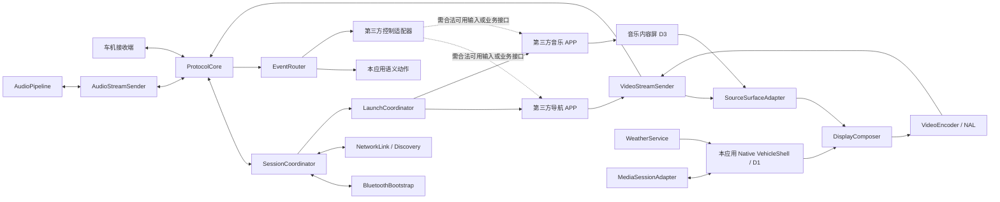

# HarmonyOS 手机 CarPlay 客户端实现方案

## 1. 目标、范围与交付边界

### 1.1 已确定的产品目标

- 平台：HarmonyOS 7.0／API 26 手机，普通应用，只使用公开 API；实际编译 API、设备系统版本及系统能力必须分别检测。
- 技术路线：NDK C/C++ 原生优先；用户同意在必须时使用最少量 ArkTS 承担系统入口和平台桥接，二进制协议/解析、合成、业务状态、媒体与日志由原生侧实现。
- 角色：手机作为 CarPlay 发送端，连接车机接收端。
- 地图：直接显示和控制**已安装的第三方导航 APP**，目标为百度地图、高德地图、华为 Petal 地图、腾讯地图；不是默认改成接入导航 SDK 后自绘地图。
- 音乐：华为音乐、QQ 音乐、糖水音乐及其他已适配鸿蒙的常用音乐应用，按具体版本逐项适配，不预设 API 或实际安装情况。
- 界面：Dashboard、天气和音乐卡片；导航可以单独全屏；还包括可打开应用的 Apps 网格、左侧或底部可配置 Dock、导航与音乐真实应用左右分屏。
- 交互：音乐控制、软件控制、背景图、白天／夜间／自动模式、打开 APP、车机事件处理。
- 连续性：Dashboard/导航全屏及分屏切换不主动重启导航；手机与投屏间转移导航要求不中断，是否满足取决于目标 APP 与平台能力。
- 调试：开发设置中提供证书与 MFi 相关调试策略；完整 TX/RX 原始数据与解码信息在可授权、安全保存的调试记录中提供。

本方案是实现设计，不是已运行的应用，范围边界如下：

- **已知验证前提**：用户确认虚拟屏幕可录制。本方案接受单屏录制已验证这一前提，但不据此推定多屏采集/合成、输入、双 APP 焦点或实车互通也已验证。
- **协议与平台边界**：既有协议文档作为会话与数据封装输入；HarmonyOS 具备 Socket、编码器或录屏接口，不代表目标原车机一定接受该发送端，也不代表不同媒体流已完成端到端。
- **产品与合规边界**：Apple 公开的 CarPlay 应用开发入口面向 iPhone 体验，并非 HarmonyOS 发送端 SDK；公开资料不能证明已有配件授权自动覆盖非 Apple 发送端。上线前须向相应权利方确认协议、认证材料及角色许可范围，未确认前不承诺官方支持或上架合规。

### 1.2 方案结论与实施顺序

**最终技术方案：条件式推进，不预设目标能力已打通。**使用 C/C++ NDK 承担协议、会话、合成及媒体处理；以最小 ArkTS/Stage 桥接系统虚拟屏、授权与启动能力；音视频采用独立处理队列和发送任务，但每个已协商 socket/媒体流维持单写者和流内顺序。按以下顺序验证：

1. **先做准入闭环**：确认合法认证与目标车机接受度（G1），再确认虚拟屏内容采集、合成与触摸路径（G2/G3）。
2. **再做媒体闭环**：逐流协商音视频，验证音频/视频并发、时间同步、队列背压和设备负载下表现（G6）。
3. **最后扩展功能**：验证导航连续性、双 APP 分屏、特殊显示区域、APP 入口和日志后，才逐项开放相应功能。

因此，本方案适合作为**分阶段原型实施方案**；完整目标和产品发布仍为条件通过。若合法认证/接收端准入、Phone 端第三方输入或内容源采集任一关键门槛失败，相关完整功能必须标记 BLOCKED/No-Go，不能用本应用自绘 UI 或单屏录制结果代替验收。文中的线程与队列设计降低互相阻塞风险，但不构成无卡顿、固定延迟或音画同步的性能保证；这些指标需在指定手机、车机和无线环境下实测。

**文档导航：**第 1–2 章界定目标与功能；第 3–6 章说明架构、连接、显示及连续性；第 7–9 章说明媒体、应用控制与事件；第 10–12、14–16 章说明平台能力、验收、实施、产品输入和认证；第 13、17–18 章说明工程结构、日志与系统验收；第 19 章集中定义手机端和车机端 UI。

### 1.3 两级公开能力

| 能力级别 | 本方案的处理 |
|---|---|
| 普通开放 API 与用户资源授权 | 作为基础能力，仍须检查设备、系统版本与授权结果 |
| 普通应用可申请的受限公开 API / ACL | 作为条件能力，**未假定用户已经获得审批**；申请失败则对应功能不可启用 |
| 系统专用、隐藏接口、改系统或 PC 专用接口 | 不作为本手机方案的实现路径 |

`system_grant` 不等于“只能系统应用”；公开的 `system_basic` 权限也不等于普通应用无条件可用。API、设备范围、ACL/签名配置、授权与运行结果都要分别判断。

### 1.4 当前不可直接承诺的部分

1. **任意第三方 APP 的原始触控**：所核对的公开通用输入注入接口在 Phone 上不能完成目标注入：ArkTS `createTouchController` 面向 PC/2in1，其他设备返回 801；所查 C 触控注入接口在其他设备无效果。不能承诺将车机 down/move/up、多指缩放注入另一个 APP 的指定虚拟屏。收到 HID 与执行地图拖动是两件事。
2. **后台任意拉起 APP**：发送端退后台后，保持 Socket/长时任务不等于拥有启动其他 APP 的权限。
3. **第三方导航的跨屏无缝迁移**：指定 displayId 启动不保证迁移既有单例、不重建 UIAbility或保留该 APP 的导航引擎。
4. **任意音乐 APP 的控制与声音捕获**：控制依赖媒体会话或该 APP 的公开业务接口；内录依赖授权并受隐私音频过滤限制。

这些项目是整体目标的前置条件，不以“只显示画面”或“只控制本应用”代替完成。若跨 APP 输入与连续迁移没有合法可用路径，完整目标应判定为阻塞，而不是宣称产品已实现。

## 2. 功能与实现路径

| 用户功能 | 设计路径 | 能力与边界 |
|---|---|---|
| 配对连接 | 经典蓝牙/SPP 引导、iAP2、加入车机 Wi-Fi、发现/邀请、认证与 RTSP 会话 | 接口、身份/认证、网络路径及目标车机兼容逐层验证 |
| 导航进入 Dashboard | 第三方 APP 保持在内容虚拟屏，将其画面合成到 Dashboard 导航区域 | 是第三方完整画面的缩放/裁剪，不是自动抽取该 APP 的专有导航 widget |
| Apps 网格 | 用户授权可发现、合法可启动且完成兼容验证的应用绘制图标、名称及可用状态 | 不默认获取所有已安装应用；网格可显示白名单中的未安装或不可启动原因 |
| Dock 位置 | 车载界面设置为左侧或底部并持久化，重算 safe area、内容区与触控矩阵 | 不把 Dock 当作额外视频流；不假定能够改车机原生侧栏 |
| 应用左右分屏 | 导航与音乐为两个独立应用源，分别缩放、合成、指定焦点与目标区域 | 必须验证可并存显示及两个内容源；音乐卡片不是完整音乐 APP 分屏 |
| 白天／夜间 | 手动 DAY/NIGHT 或 AUTO 根据受支持的车机状态切换本应用主题 | 不承诺第三方 APP 的主题可由本应用强制改变 |
| 天气卡片 | 本应用通过合法天气服务获取数据并绘制 | 位置可由用户选城市；不得假设可读取第三方导航目的地 |
| 音乐卡片与控制 | 对已授权且接入媒体会话的播放器读取元数据/执行动作；或使用播放器公开接口 | ACL、会话存在与支持动作分别检查 |
| 导航单独全屏 | 保持导航 APP 及源虚拟屏不变，只改变输出合成布局 | 与实际跨屏迁移分开；这是优先验证的连续切换 |
| 手机/投屏不中断转移 | 对指定导航 APP 验证实例迁移、公开继续导航接口或该 APP 支持的多屏行为 | 不存在通用的“迁移任意 APP 且保存内部状态”保证 |
| 软件控制 | 本应用会话/布局/主题动作；第三方仅经公开、已验证的业务入口 | 不拥有全系统 UI 控制权限 |
| 主题与背景图 | 本应用 Dashboard/Shell 的背景、卡片样式与昼夜模式 | 不改第三方 APP 内部皮肤、系统 CarPlay UI 或车机原生 UI |
| 打开 APP | 应用白名单、合法 Want/App Link、前台启动与指定屏幕校验 | 后台、未导出组件、单例与焦点均可能限制 |
| 事件处理 | 协议解帧 → 会话/显示匹配 → 输入/语义路由 → 动作结果 | 协议应答不等于第三方 UI 已执行 |

## 3. 总体架构

采用 **C/C++ NDK 原生核心 + 最小 ArkTS/Stage 入口桥接**。原生侧负责协议、64 位数值、UI 场景状态/布局/绘制、视频合成、媒体、日志和事件；仅当对应公开系统能力没有可用 NDK 路径时，使用必要的 ArkTS UIAbility/授权/启动/显示等桥接。各能力是否存在 Phone 可用的原生接口需逐项确认，不因“NDK 优先”假定所有系统接口都有 C API。



图中的内容虚拟屏采集/合成以及第三方控制仍需通过平台验证；箭头不代表现有代码已闭环。

### 3.1 模块职责

| 模块 | 职责 |
|---|---|
| CapabilityProbe | 系统/API、设备类型、权限/ACL、编码器、目标 APP 与功能状态探测 |
| SessionCoordinator | 连接状态、资源归属、会话代际、失败/恢复与清理 |
| ProtocolCore | iAP2、TLV8、RTSP、媒体 framing、密钥派生、时间同步、输入事件 |
| BluetoothBootstrap | SPP 服务/连接、字节流读写、正常系统配对与断连 |
| NetworkLink / Discovery | STA/P2P 路径、接口绑定、mDNS、反向控制服务、动态端点 |
| VirtualDisplayManager | 申请/检查权限，按车机显示信息与已选档位创建输出虚拟屏，映射 screenId/displayId/Surface，管理生命周期 |
| VehicleDisplayProfile | 保存车机原生画布尺寸、实际输出档位、可视轮廓、安全边距、背景与内容区等显示适配参数 |
| DisplayModeRegistry | 保存按车机/编码器验证过的离散 CarPlay 输出档位；没有匹配项时仅开放车机原生档位 |
| AudioStreamRouter | 按音频用途、方向与协商结果路由媒体、导航提示、电话及麦克风流，不按编号臆断用途 |
| MediaSendScheduler | 管理有界媒体队列、音频时效优先、背压和性能指标；协调独立工作任务，不允许并发写同一流 |
| AudioStreamSender / VideoStreamSender | 分别发送已协商音频/视频流；每个 socket 单写者，维护该流的封装、序号与加密状态 |
| VehicleShell | 本应用绘制 Dashboard、Dock、天气/音乐卡片、APP 菜单和状态 |
| SourceSurfaceAdapter | 取得被授权的第三方内容源，明确像素/纹理与 Surface 所有权 |
| DisplayComposer | 按车型显示配置裁剪/排布导航源、Dock、Apps 与自有卡片，合成为一张车载画面 |
| VideoEncoder / NalAdapter | 编码、配置/NAL 格式、时间戳、关键帧与有界队列 |
| AudioPipeline | 合法内录/自有音频、格式转换/编码、协商流、麦克风业务 |
| LaunchCoordinator | 已验证入口、前台 context、displayId、单例行为与调用结果 |
| MediaSessionAdapter | 获准后访问目标媒体会话，支持动作与播放状态更新 |
| EventRouter / InputTargetAdapter | HID 解码、坐标与触点状态、本应用动作和受限第三方控制 |
| TouchTransformRegistry / HitTestRouter | descriptor 到画布/源屏的坐标变换、布局代际管理、可视区裁剪与稳定控件命中路由 |
| ThemeStore / AppRegistry | 本应用主题持久化、图片资源与支持 APP 白名单 |

C/C++ 负责原生 UI 场景/绘制、授权状态机、会话、协议、64 位二进制、合成、音视频、事件与日志。仅系统需要 Stage 入口或某项能力没有可用 Phone NDK API 时，最小 ArkTS 壳负责启动生命周期和对应系统调用，不重复维护业务状态；原生侧通过稳定 N-API 桥接。

边界数据：跨 N-API 的二进制用 `ArrayBuffer`/外部缓冲区与明确所有权传递；u64 用 8 字节或十进制字符串／`BigInt`（以目标 N-API/系统支持为准），不经 JS Number 或 JSON 隐式舍入。媒体帧走原生 Surface/纹理/缓冲区，N-API 不逐帧传 Base64 或 JSON；异步任务使用会话代际和线程安全队列，避免悬空句柄。

## 4. 配对与连接

### 4.1 优先无线链路

1. 用户在手机前台启动连接，完成 Bluetooth 权限与正常系统配对。
2. 根据目标接收器角色注册或连接 SPP 服务；SPP channel 与协议 UUID 分开处理。阻塞操作不放在 UI 主线程。
3. iAP2 字节流组包、校验、同步和 Identification；完成 MFi 验证后发送设备状态问候，并按车机声明处理可选 EA/HID 阶段。
4. 按车机交付的 SSID、安全参数、地址与端口建立 Wi-Fi 路径。收到 `0x5703` 后并行开始入网和 CarPlay 可用通知，不等待 Wi-Fi 关联完成才发送 `0x4300`；不能从 `DIRECT-` 名称推断必须调用 P2P 接口。
5. 检查 Wi-Fi 实际关联、接口、IP、路由和 IPv6 scope；保持媒体 Socket 走车机网络，不默认修改整个进程的网络路径。
6. 启动蓝牙监听前先发布手机 `_carplay-ctrl._tcp`；切换到车机 Wi-Fi 后重注册到目标网络。完整 `0x4301` 端点可直接使用；端点不完整时事件驱动等待 ctrl 邀请最多 4 秒、再等待 mDNS 解析最多 3 秒。
7. 建立主控制连接，执行已验证的 AirPlay 配对与初始会话 SETUP；按当前 profile 查询 `/info`、Event/Timing 与媒体能力。临时连接失败按 2 秒间隔重试，配对窗口最长 120 秒。
8. 从 `/info` 选择主显示目标，读取其 UUID、`widthPixels`、`heightPixels`、方向/帧率等已声明信息；把车机报告的宽高作为原生输出档位，不使用手机屏幕尺寸代替。
9. 从当前车机兼容 Profile 的已验证离散档位中生成分辨率选项；缺少该车机/编码器组合的验证记录时只显示“车机原生”。选定档位后创建输出虚拟屏与合成画布，再逐流 SETUP，并以响应端口、codec 配置和首帧结果确认最终可用参数。
10. 按实际 SETUP 响应建立 Event、Timing、视频、音频及可选数据流，发送有效配置和首帧，按当前 profile 需要 RECORD/更新资源状态。

身份材料通过合法来源管理；长期私钥与会话密钥分开存储，优先使用适用的系统安全存储。不得通过伪造成功状态绕过配对、签名或 AEAD 验证。

无线 iAP2 阶段的等待应保持可恢复：旧式 Wi-Fi 交换按 1.5 秒、补发问候后 1.3 秒、重发一次 `0x5702` 的顺序处理；`0x4301` 有凭据时等待 3 秒、无凭据时等待 8 秒。若车机声明会发 `0x4301` 但端点未到，保留控制链路处理晚到消息，最长等待 5 分钟后再关闭当前 RFCOMM 会话并继续监听。上述超时只控制流程调度，不代表认证成功；MFi 证书与签名验证仍须通过。

### 4.2 有线范围

普通 USB 设备/配件访问 API 不表示可以配置任意手机 gadget、角色切换与 NCM 功能。USB 方案单列能力验证，不将其作为无线方案失败后的自动替代，不把 USB bulk 通信当作完整 CarPlay。

### 4.3 连接状态

```text
Idle → PermissionReady → BluetoothReady → Iap2Ready
 → NetworkReady → ControlConnected → Authenticated
 → SessionConfigured → DisplayProfileResolved → StreamsConfigured → Presenting
 → Reconnecting / PartialStop / Stopped
```

单独维护 eventReady、timingReady、videoConfigReady、audioReady、sourceVisible、launcherEligible与thirdPartyInputSupported；不得用一个 connected 布尔值覆盖全部状态。

## 5. Dashboard 与导航全屏

### 5.1 呈现布局

```text
Dashboard
┌───────────────────────────────┬───────────────┐
│ 第三方导航内容源               │ 天气卡片      │
│ 保持源虚拟屏与APP实例          ├───────────────┤
│ 输出端按布局缩放/裁剪          │ 音乐卡片      │
└───────────────────────────────┴───────────────┘
│ 本应用 Dock / 主页 / APP目录 / 连接状态         │
└───────────────────────────────────────────────┘
```

导航内容仍是目标 APP 的原生画面。没有该 APP 的公开接口时，不能抽取目的地、路线、ETA、maneuver 或把其内部地图拆成独立语义组件。缩小完整画面也不等于它已自动适配 Dashboard；必须检查文字可读性、比例、黑边、提示框和安全区。

天气、音乐和 Dock 由本应用绘制，合成进同一主屏视频流。它们不是每个卡片各自开一条 CarPlay 视频连接；可选仪表副屏另外协商。

### 5.2 三屏与双应用的候选路线

- D0：手机主屏，用户正常使用手机。
- D1：本应用真正可见的 `VehicleShellAbility`，呈现原生 UI 与菜单。
- D2：百度/高德/Petal/腾讯等导航 APP 的候选内容屏。
- D3：选择音乐真实应用分屏时的音乐 APP 候选内容屏；音乐卡片模式不需要 D3。

D1/D2/D3 为逻辑目标，只有平台允许独立创建、同时录制且两个目标 APP 接受启动到对应显示时才映射到独立虚拟屏；也可在目标设备允许的情况下验证其他合法多窗口组合，不能默认任一组合可用。单个虚拟屏可录制是**用户已验证的前提**，不等于多屏并发录制、双 APP 同时运行、GPU 合成、前台资格、焦点和输入路径已验证。

#### 5.2.1 车机显示尺寸与离散像素档位

- 会话建立后读取 `/info` 的目标 `displays[]` 条目，使用其显示 UUID 和 `widthPixels × heightPixels` 作为车机原生画布；`maxFPS` 等字段仅按实际响应记录。不要在连接前用手机面板分辨率猜测车机画布，也不要把 `/info` 的当前尺寸误认为它已公布了所有可选分辨率。
- 手机设置仅提供离散档位，不接受任意宽高输入或自由百分比。每个档位须登记在 `DisplayModeRegistry`，且已在相同车机显示 Profile、输出编码器和目标发送链路组合上验证；选项集合是“车机原生档位 + 当前组合已验证档位”，按显示方向/宽高比和编码器边界过滤。没有替代档位的实测记录时，列表只显示车机原生尺寸。
- CarPlay 资料/样例中出现过 `800×480`、`1280×720`、`1920×720` 等画布，但它们不是所有车机通用的官方白名单；仅当当前组合有验证记录时才可显示，不能据此对其他车机开放选择。
- 默认创建尺寸严格等于车机报告的原生宽高。选择其他已验证档位时，以所选像素创建车载输出虚拟屏/编码画布，再把合成内容映射到车机原生显示坐标；保持比例，使用已验证的留边或裁切策略，禁止拉伸。导航/音乐内容源屏与车载输出画布分开记录尺寸和变换。
- 逐流 SETUP、codec config/视频首帧和解码呈现结果共同作为成功判据。车机/编码器拒绝或首帧尺寸不符时，不宣称档位可用；断开当前媒体流并回到该 Profile 已验证的原生尺寸重建。分辨率变更需重新建立相关虚拟屏与媒体协商，不在活动流中静默改尺寸。

车机点菜单时，仅由真实可见且满足系统前台条件的 Shell context 启动合法目标。不使用隐藏窗口、空白一像素窗口或其他方式伪造前台。Shell 前台只可能处理部分启动问题，不能自动获得 D2/D3 的跨 APP 触控。

#### 5.2.2 显示坐标与触摸映射

- 将车机 `/info` 中的显示 UUID、原生宽高和方向作为显示画布资料；它们本身不代表触摸 HID 报告的坐标最大值。触摸范围必须从当前协商的触摸 HID UUID、descriptor、report ID 与字段定义读取，并记录 X/Y 最小/最大值、轴序、接触槽和方向。资料缺失、descriptor 未识别或显示目标不唯一时，不猜测比例、不执行点击。
- 仅对 descriptor 确认的绝对坐标使用范围归一化：`u=(xRaw-xMin)/(xMax-xMin)`、`v=(yRaw-yMin)/(yMax-yMin)`；再依实测轴交换/反转、屏幕方向和 Profile 校准变换映射到车机原生画布，并按 `[0, widthPixels-1] × [0, heightPixels-1]` 有效范围取整。相对坐标或已归一化字段必须按 descriptor 语义另行转换，不套绝对轴公式。禁止先把原始坐标直接当输出像素。
- 从原生画布到编码/虚拟输出画布应用同一份矩阵变换，包含选定像素档位、缩放、偏移、安全区和已验证的 letterbox/crop 策略。命中测试在 DisplayComposer 当前实际布局坐标中进行；黑边、裁切区、不可视遮罩外及无效/越界坐标直接拒绝，不吸附到附近按钮。导航/音乐分屏再用命中区域的逆变换映射至对应 source display 的像素坐标。
- 输出画布尺寸、HID 坐标校准和渲染变换都带 `profileGeneration`；每个 pointer-down 锁定 `sessionGeneration + layoutGeneration + targetAppId/sourceDisplayId`。旋转、分辨率、Dock、分屏、窗口或 Profile 改变时 cancel 所有旧触点、递增代际并丢弃迟到事件，禁止旧坐标落到新控件。
- 原生 Shell 控件以稳定 `actionId` 命中，只有同一目标的有效 down/up 才提交一次语义动作；Apps 网格命中后由 AppRegistry/LaunchCoordinator 启动绑定的 `appId`。第三方内容区只有在目标 APP、目标虚拟屏及该 Phone 输入 API 全部验证可用时才可注入；否则明确不可操作，绝不将触摸注入手机主屏。具体状态机见 §9.2。

### 5.3 采集、合成与编码

候选管线：

```text
第三方APP → D2异源显示 → 授权的SourceSurface/采集输出
 → 可采样纹理或图像 → 合成导航区域与D1卡片
 → 编码器输入Surface → H.264配置/NAL → CarPlay视频
```

用户已验证虚拟屏可录制，本方案直接采用该结果作为单源录制前提；仍须确定已验证的设备、系统版本、授权方式与录制 API，才能对接其真实输出。**可录制不等于已有可由原生合成器采样的纹理，也不等于能并发录制多个虚拟屏。**需要单独验证 D2/D3 同时取得内容源、叠加天气/音乐卡片、同步合成并喂给车机编码器。若目前只能将完整虚拟屏直接编码，嵌入 Dashboard 与真实双应用分屏仍未完成，不以录制通过替代两项验收。

优先保持源虚拟屏尺寸稳定；根据车机 viewArea 做合成变换。H.264 为首选候选，是否可用及具体规格以设备和车机能力为准；不提前承诺 HEVC、零拷贝或固定帧率。

### 5.4 Dashboard ↔ 导航全屏

`PresentationMode = DASHBOARD | NAV_FULLSCREEN | SPLIT_NAV_MUSIC | APPS_GRID` 控制输出布局与可见区域。仅切换 Dashboard/导航全屏时：

- 不关闭导航 APP，不销毁 D2，不重新启动导航。
- 不重建 CarPlay 配对或整个控制会话。
- 优先保持输出视频规格；必要的编码配置变化按新代际发送配置与关键帧。
- 触摸映射随布局代际更新；旧布局事件丢弃并释放触点。

这比迁移第三方 APP 的窗口更可控，但仍依赖源显示、后台存活和合法输入路径。

### 5.5 Apps 网格、Dock 与双应用分屏

**Apps 网格：**原生 Shell 根据 `AppRegistry` 构建网格，显示图标、名称、类别、安装状态和能力状态；图标/名称只能来自用户授权获取、应用公开信息或自有合法素材。支持分页、焦点移动与点击。点击前验证目标版本、合法 Want、前台资格、指定屏幕和 `launchable`；不得为了填满网格宣称所有已安装 APP 都可启动或可操作。

**Dock：**`DockPosition = LEFT | BOTTOM`，用户设置持久化。修改后重新计算画布、安全区、卡片、网格焦点与 source→canvas 变换；按当前触点绑定的布局代际取消旧触点，不能把此前触点投递到新位置。Dock 与 Dashboard 均是发送端合成 UI，不独立建立视频流。

**真实左右分屏：**`PresentationMode = SPLIT_NAV_MUSIC` 时，左侧来源为导航 APP，右侧来源为音乐 APP 的原生界面，两者分别有 `sourceId/displayId`、尺寸与逆坐标变换；布局使用可配置比例并遵守车型显示配置中的有效内容区。每个源独立追踪创建、画面更新、生命周期与输入资格。只显示专辑封面/播放按钮的自绘音乐卡片是另外一种 Dashboard 模式，不得算作双 APP 分屏完成。

**车型显示区域：**维护独立的 `VehicleDisplayProfile`，把车机报告的原生矩形画布、已选输出档位与用户可视/交互区域分开描述。Profile 至少包含显示 UUID、原生宽高、所选离散档位、输出方向/帧率、可视区域边界或遮罩、安全边距、Dock/Apps 内容区、背景模式与图片/颜色、缩放/偏移及坐标变换。Dashboard、Apps、Dock、导航和分屏内容按有效区裁剪和重排；不可用区不放按钮或关键文字，命中测试也必须拒绝该区域的输入。背景可以绘制到整个矩形画布，前景交互内容则限制在可视安全区。不得假设车机通过 CarPlay 协议告知了非矩形几何或能裁剪任意轮廓；需要在目标接收端实测 Profile 与输出映射是否有效。

退出分屏仅改变合成布局，不主动关闭两个 APP；源失效时仅该区域显示不可用状态，不无限停留旧帧。车机输入落在哪个区域，就只路由到该区域目标；第三方应用仍需要合法的 Phone 输入能力，禁止注入手机主屏。两个真实应用是否并存、焦点、音频路由、内存及输入可行必须单独验收。

### 5.6 手机端与车机端 UI 分离

UI 设计集中放在第 19 章，并明确分成两个界面：**手机端是连接客户端**，主页专注开启、等待/取消和关闭连接；设置、日志、关于等页面从标题栏右上角的“…”菜单进入。**车机端是独立的投屏 UI**，负责 Dashboard、Apps、导航全屏与双应用分屏，不复用手机连接主页、不镜像手机页面。车机画面仅在对应会话/显示能力实际可用时输出。

## 6. 手机与投屏不中断转移

### 6.1 必须区分三件事

| 需求 | 处理 |
|---|---|
| Dashboard ↔ 导航全屏 | 同一导航源，只换合成布局 |
| 手机使用其他 APP，车机继续导航 | D2 和导航 APP 保持运行，验证生命周期、焦点与背景限制 |
| 导航 APP 从车机转到手机，再转回车机 | 涉及第三方实例/窗口迁移与导航业务恢复，不能仅靠视频流不断证明 |

### 6.2 真正转移的适配策略

按目标 APP 建立兼容记录，优先使用该 APP 明确提供的继续导航/跨设备或多屏入口。若采用 `startAbility(..., displayId)`，必须验证：

1. 已在 D2 运行的单例是否被迁回 D0，是否重建 UIAbility。
2. 导航服务、定位、语音提示、路线与进度是否仍有效。
3. D2 内容是否被移除；移除后输出端不能仍显示旧帧并宣称导航有效。
4. 返回车机是否复用同一导航任务，是否出现重新算路、重复导航或需要重新输入目的地。

普通应用不能保存和恢复任意第三方 APP 的内部导航状态。`NavigationProjectionState` 只保存显示模式、目标入口、连接代际和公开接口提供的恢复标识；不得假设有通用 routeId/内部任务令牌。

如手机在本客户端中观看同一源画面，这属于“画面呈现位置切换”，不是原导航 APP 已无缝迁移；不能用它替代要求的真实转移。

### 6.3 迁移失败

保留当前仍有效的导航任务，停止进一步迁移并提示能力限制。未经验证不调用强制停止、不清应用数据、不重启导航、不自动改成主屏镜像。导航源丢失时明确显示不可用状态，而不是无限冻结最后一帧。

## 7. 音乐卡片、控制与音频

### 7.1 目标播放器适配

- 获得所需公开受限权限后，使用 AVSession controller 枚举/选择允许访问的媒体会话。
- 先读取支持动作，再启用播放、暂停、上一首、下一首或 seek；不是所有会话都提供全部操作。
- 按元数据与播放状态更新标题、歌手、专辑图和进度；没有数据时显示未知，不猜测当前曲目。
- 无对应会话时，只能使用该播放器公开且经过验证的业务入口；没有入口的动作不可用。
- 本应用自己的 AVSession 与跨应用管理权限分开；不能用本应用会话控制任意播放器。

### 7.1.1 首批应用适配清单

目标清单不等于已完成接入；所有项目初始状态为 `UNVERIFIED`，以目标手机上的具体鸿蒙版应用、版本、导出入口、媒体会话与实测为准，不编造包名、Ability、URL Scheme 或深链参数。

| 类别 | 目标应用 | 待分别验证 |
|---|---|---|
| 导航 | 百度地图、高德地图、华为 Petal 地图、腾讯地图 | 手机是否安装鸿蒙适配版本；公开可启动入口；指定屏幕；导航任务连续；输入/公开语义动作；与音乐分屏并发 |
| 音乐 | 华为音乐、QQ 音乐、糖水音乐 | 安装及鸿蒙适配版本；公开启动入口；媒体会话及可访问权限；每项控制动作；允许的声音捕获；真实分屏源 |
| 其他音乐 | 用户安装的鸿蒙适配音乐应用 | 同上；未测试保持不可用或未验证，不承诺全覆盖 |

每个版本以 `UNKNOWN / AVAILABLE / BLOCKED_PERMISSION / UNSUPPORTED / VERIFIED` 记录启动、显示、原始触控、语义控制、音频、迁移等**分项**状态；不能将“能启动”标记为“全面支持”。如应用不存在或名称/产品有变动，提示用户选择当前实际安装的目标，不猜测替代对象。

### 7.2 CarPlay 音视频与控制通道

连接时先读取 `/info` 能力，再按 profile 对每个可用流独立 SETUP。流类型、业务用途、载荷格式与方向是不同维度；表中传输方式是常见路径，不是所有接收端的固定要求。

| 通道/类型 | 用途 | 方向 | 承载与建立 | 客户端处理及限制 |
|---|---|---|---|---|
| `type 110` | 主屏视频 | 手机 → 车机 | 显示 UUID 单独 SETUP；按响应 `dataPort` 建 TCP 数据连接，按 codec config 解析视频 | 一个合成画面承载 Dock、Apps、Dashboard、导航/媒体等 UI 区域；这些区域不是各自独立视频流 |
| `type 111` | 可选仪表/第二显示 | 手机 → 车机 | 仅在车机声明对应显示并接受独立 SETUP 时建立 | 不保证所有车机都有；不与 type 110 或主屏布局混为一条流 |
| `type 96` | 兼容/旧式音频 | 依该 profile | 依 legacy audio 能力及协商参数 | 不因编号假定 codec、业务用途或方向 |
| `type 100` | 主实时音频 | 通常手机 → 车机；输入流可反向 | `audioType`、`audioFormat`、`input` 与端口/方向需逐流协商；常见实时传输为 UDP/RTP | `audioType` 区分媒体、提示/导航、电话、语音等业务；并不保证每种业务各有独立流 |
| `type 101` / `102` | 其他或高规格实时音频用途 | 以协商结果为准 | 仅在能力声明且 SETUP 接受时使用 | 不可仅凭编号指定媒体/电话或固定采样率、codec |
| `type 103` | 可选缓冲音频 | 以协商结果为准 | 需相应 buffered-audio 能力及控制流程 | 与低延迟实时 RTP 音频分开处理 |
| `type 104–109` | 可选音频/冗余变体 | 以协商结果为准 | 仅按当前 profile、能力与 SETUP 结果启用 | 不对未声明用途的流发数据，不将此范围视作通用可用集合 |
| 麦克风/语音输入 | 车机麦克风送往手机，用于明确支持的语音业务 | 车机 → 手机 | 由具体音频 SETUP 的 `input`、用途、格式、端口和实际数据方向共同确认 | 仅收到 Siri/语音按钮事件不等于麦克风流已建立；还要校验系统录音权限/业务授权，不能宣称因此获得 Siri 能力 |
| Event | HID、按键、资源与会话事件 | 双向，按消息定义 | 独立 Event 连接/端口与 framing | 输入事件路由与视频画面分离；收到事件不代表目标 APP 已执行动作 |
| Timing | 时钟同步/时间信息 | 双向 | 通常为独立 UDP 交换及协商端口 | 与 RTP 时间戳、TCP 序号及 Event 事件序号分别维护 |
| `type 130` | profile 特定数据流 | 依 `clientTypeUUID` / profile | 独立 SETUP、stream ID、端口与相应密钥/格式 | 不是通用音视频流；iAP2 tunnel、车辆数据或 UI 同步等不能仅凭类型号判定 |
| iAP2 控制 | 配对、能力与配件控制消息 | 双向 | 前置控制链路；无线常见 RFCOMM，后续网络/USB 路径依接入方式 | 不等同于视频、音频或 type 130 数据流 |

业务映射原则：媒体播放、导航提示/ducking 与电话下行均按对端公布的音频用途和已接受格式发送；不得仅从“导航”“电话”名字推定一定存在独立音频连接。电话上行可能依协商音频输入，也可能由系统电话/蓝牙路径承担，必须实测所选架构，避免重复路由。音乐、导航提示与电话状态还需和音频焦点/资源事件协调；音量 ducking/恢复以真实协商事件为准。

### 7.3 车机音乐事件

媒体 HID、iAP2 Consumer Control 与 `/command` 语义分开解码，归一化后交给选中的 MediaSessionAdapter。按下与释放配对，避免一键触发两次。动作提交、控制事务应答与实际播放状态变化分别表示。

### 7.4 声音传输

系统内录候选为 API 26 的 ArkTS `AudioCapturer` 或 C/C++ `OH_AudioCapturer`，启动授权结果异步返回；仅在系统授权成功后采集，并遵守媒体录制类别和隐私过滤。官方接口说明没有提供按指定第三方 APP 或虚拟屏隔离音频的保证，也不保证所有播放器的受保护/隐私音频可取。若实测捕获为混合系统媒体，不能声称只转发选定播放器；必须让用户明确选择启用该音频路径，验证混音及隐私行为，否则关闭系统内录或改用合法提供的音频源。不得把电话、受保护内容或其他 APP 声音偷偷送入车机。

车机麦克风上行与手机麦克风权限不同；接收到的麦克风只交给明确支持的本地语音业务。HarmonyOS 客户端不能因此宣称拥有 Apple Siri。权限拒绝/撤销时停止相应采集并更新功能状态，不绕过隐私过滤。

### 7.5 音视频并发与发送调度

音频和视频使用**独立、有界的处理队列及发送任务**，避免视频编码/写入阻塞音频处理，也避免音频采集或磁盘日志阻塞视频采集。共享执行资源时，`MediaSendScheduler` 优先保障实时音频的发送时限，不让非实时日志或过期视频工作挤占音频；这只是应用内调度优先级，不代表操作系统或 Wi-Fi 网络 QoS。独立线程只隔离应用内的等待；两类媒体仍共享 CPU、内存带宽、无线网络和车机接收能力，因此不能承诺绝对无卡顿。

| 管线 | 执行与顺序 | 队列/拥塞策略 |
|---|---|---|
| 音频 | 采集/音频源、格式转换和编码与发送解耦；每个已协商音频 socket 使用单写者，按 profile、方向和时效发送 | 有界低延迟队列；记录积压、过期和丢包。丢弃或恢复按协商 codec/profile 执行，不因追赶积压无限增加延迟；只有 profile 明确支持时才使用重传/冗余 |
| 视频 | 合成/编码回调与网络发送解耦；每条视频流单写者，按完整配置帧/访问单元及流内顺序发送 | 有界队列并监控编码/发送积压；优先在编码前丢弃过期输入帧。不得任意切掉已编码 H.264 访问单元或其中的任意字节；若必须重置码流，按有效配置和关键帧恢复 |
| 控制、Event、Timing | 独立于媒体发送调度；短事务不等待音视频队列清空 | 控制队列有界并监控超时；按协议时钟/时间戳做跨流关联，不将控制事务序号当作媒体序号 |

**并发不等于同一连接多线程写入。**每个 socket/媒体流保持唯一写入者，协议 framing、RTP 序号、时间戳以及该流的加密 counter/key 状态按流串行维护；不同协商流可以在独立任务中并行。线程/任务数有上限，不为每个数据包或每帧新建线程。日志写盘只走后台有界队列，不能同步阻塞采集、编码和发送线程；完整抓取写入跟不上时依第 17 章标记 `INCOMPLETE`，不能静默丢日志仍宣称完整。

发送任务使用统一单调时钟和媒体时间戳；按当前 Timing/媒体 profile 维护流间时序，不以“两个线程同时跑”代替音画同步。TCP 视频连接的阻塞可由独立音频任务隔离应用线程等待，但 TCP 重传、共享无线链路拥塞或车机解码负载仍可能造成卡顿；UDP/RTP 音频也可能丢包，需按真实协商能力监控和处理。发现持续背压时先记录队列深度、编码/发送耗时、丢帧/丢包和设备热状态；只有在编码器与对端 profile 支持时才调整码率/帧率，分辨率或 codec 改变必须重新协商，不得静默改变已接受的视频格式。任何降级阈值、延迟目标和可接受丢包率都留给目标设备实测确定。

## 8. 软件控制、打开 APP 与主题

### 8.1 APP 白名单

`AppRegistry` 保存用户选择的支持 APP、合法公开 Want/App Link、允许显示模式和兼容结果。使用已导出的入口，不凭空编造 Ability 名称或 URI 参数；不默认全量枚举安装包。

客户端内部的“打开 APP”采用以下版本化路由 URI；它是供本应用 `LaunchCoordinator` 解析的命令格式，不是 HarmonyOS 通用启动 URI，也不直接交给第三方 APP：

```text
carplay-client://v1/apps/{appId}/launch?target={phone|vehicle-main}&mode={phone|dashboard|fullscreen|split-nav-music}

示例：
carplay-client://v1/apps/amap/launch?target=vehicle-main&mode=fullscreen
carplay-client://v1/apps/qq-music/launch?target=vehicle-main&mode=split-nav-music
```

`appId` 是 AppRegistry 内的稳定别名（例如 `amap`、`baidu-map`、`petal-maps`、`qq-music`），只允许预登记的 ASCII slug，不是包名、Ability 名或第三方 URI scheme。`target` 与 `mode` 均为必填枚举，组合必须在目标 APP 的 capability allowlist 内；URI 不接受任意 `bundleName`、`abilityName`、`displayId` 或可执行参数。组合语义固定为：`target=phone&mode=phone` 表示经前台合法 context 在手机主屏启动；`target=vehicle-main` 仅允许 `mode=dashboard`、`fullscreen` 或 `split-nav-music`，表示把 APP 纳入对应车机合成场景；其余组合一律拒绝。车机场景不是 HarmonyOS 的 displayId；LaunchCoordinator 按已验证的 APP 角色和 mode 选择 D2 导航源或 D3 音乐源，再由 DisplayComposer 合成到车机主画面。路由器校验 scheme/authority/version/path、百分号编码、重复/未知参数、枚举值及当前会话后，将别名映射成经过验证的显式 HarmonyOS Want（含已验证 bundle/Ability 与运行时解析的 StartOptions.displayId）或该 APP 官方公开 App Link。具体包名、导出 Ability 和 App Link 模板按实际应用版本入库，不在方案中伪造。

第三方 APP 的实际深链 URI 是另一个对象：仅将厂商公开且在目标 HarmonyOS 版本实测可用的 `https` App Link 或应用自有 scheme 存入该 `appId` 的 `verifiedEntry`；不假定存在跨应用统一 URI，不猜测地图/音乐应用 scheme。CarPlay `requestUI` 中的 URL、iAP2 App Links 消息与本客户端路由 URI 也互不等同，不能把收到的任意 URL 直接传给 `startAbility`。若目标仅有未验证深链，则只允许走已验证的显式 Want 入口，否则拒绝启动并给出原因。

启动时检查真实前台 context、目标 displayId、当前会话和入口版本。screenId、displayId、Surface ID 分别管理，不能假定相等；找不到匹配显示目标时不静默使用 D0。

后台启动失败返回本应用状态 `NEEDS_FOREGROUND`，提示用户正常回到客户端；不申请仅系统可用的后台拉起权限冒充普通能力。真实可见 Shell 的前台调度路线通过测试后，也只对对应设备/APP组合开放。

### 8.2 软件控制分类

| 控制类别 | 路径 |
|---|---|
| 本应用主页、卡片、布局、连接、音频选项 | 本应用业务动作，可自行实现 |
| 第三方导航搜索、继续导航、音乐动作 | 目标 APP 已提供的公开语义接口，逐项验证 |
| 地图连续拖动、多指缩放、任意第三方按钮 | 需要合法的目标屏输入能力；公开 Phone 路径未闭环，不伪造成功 |
| 安装/卸载、系统设置、任意进程控制 | 不属于该普通应用软件控制范围 |

无障碍旧接口不作为通用原始输入或虚拟屏手势方案；不以自动启用辅助服务、模拟系统点击或改写焦点规避限制。

### 8.3 主题与背景图

`ThemeStore` 管理本应用背景图、明暗色、卡片样式和字号。图片通过用户选择导入，限制解码尺寸/内存，缓存车载输出适用版本。

`ThemePolicy = AUTO | DAY | NIGHT`：DAY/NIGHT 分别是用户手动白天／夜间，AUTO 依据当前会话收到的有效车机昼夜状态；没有状态时采用用户配置的默认主题，不用假造车灯或时间数据。收到 `setNightMode` 读取 Boolean，并在 AUTO 下更新 Shell/合成器；手动选择优先于车机自动输入。保存 `themePolicy`、背景图 URI/授权与图像处理版本，应用重启后恢复；失去图片访问权限时回退内置背景并提示。第三方导航自己的主题只在其公开接口支持时同步。

背景图只覆盖本应用绘制区域，不能声称替换第三方导航皮肤、官方 CarPlay 内部背景或车机原生界面。显示切换不重新配对，也不重启导航。

## 9. 事件处理

### 9.1 事件流水线

```text
控制/Event/iAP2字节
 → 完整消息恢复与AEAD/checksum检查
 → 识别命名空间、UUID/session与会话代际
 → NormalizeEvent
 → 检查当前显示、资源归属和目标能力
 → OWN_UI / MEDIA_SESSION / THIRD_PARTY_ADAPTER
 → 动作提交状态与实际业务状态
```

##### 事件坐标与动作边界

收到 `down` 时，将当前画面的触点与布局版本绑定。先按车机 HID descriptor 将坐标变换到输出画布，再按导航内容区域的逆变换映射到源屏坐标；落在黑边、遮挡区或区域外的事件不发送给导航。移动期间沿用该触点的目标；布局/会话代际改变、窗口隐藏或网络断开时产生内部 cancel 并清理全部触点。变换的旋转、裁剪与缩放只应用一次。

**普通应用可以在自身 Shell 按坐标处理事件，但没有因此获得向第三方 UIAbility 合法注入的能力。**系统没有提供可用目标时返回 `UNSUPPORTED_TARGET`；不能把 HID 接收、坐标计算或事务 200 写成地图已响应。

以下类型是本工程内部契约，不是新增 CarPlay 消息码：

```text
NormalizedEvent
  sessionGeneration
  displayTarget / layoutGeneration
  sourceNamespace
  kind: TOUCH | KEY | MEDIA | MODE | UI_REQUEST | VOICE | STREAM_CONTROL
  phase / payload
  targetAppId?
```

### 9.2 关键事件与策略

| 事件 | 处理 |
|---|---|
| HID down/move/up/cancel | 按协商 descriptor 解码；按当前坐标变换/代际命中 Shell 控件或唯一 source display；维护多点触点生命周期；无效/遮罩外/过时代际丢弃并 cancel |
| 媒体键 | 查询目标支持动作后经媒体会话或公开接口执行 |
| 旋钮/方向键/确认/返回 | 本应用菜单可处理；第三方语义/输入能力单独判断 |
| `changeModes` / `modesChanged` | 更新资源/app状态，仅改变受影响部分 |
| `setNightMode` | 更新本应用主题；不假设第三方主题同步成功 |
| `requestUI` / 打开应用请求 | 校验合法目标与启动资格，不把任意 URL 直接交给系统执行 |
| `requestSiri` 类语音动作 | 归一化预热/按下/释放；仅进入已实现的本地语音流程，不冒充 Siri |
| `forceKeyFrame` | 请求编码器关键帧，保持媒体代际一致 |
| 流停止、TEARDOWN、EOF | 按流/会话作用域停送、释放触点、密钥与端点 |

**触摸命中与动作路由：**每个 HID 报告保留原始坐标、report ID、触点 slot、接触状态、方向与时间戳；使用 §5.2.2 的 descriptor 范围和坐标矩阵转换，不以输出分辨率直接解释原始 HID 数值。当前 DisplayComposer 场景树按明确 z-order 命中：模态层/弹层 → Dock → Apps 图标 → 本应用卡片/按钮 → 导航/音乐源区域 → 背景。被遮罩裁剪、黑边或安全区外输入丢弃。Shell 控件 down/up 必须落在同一稳定 `actionId` 才执行一次绑定行为；拖动、滑动、长按及多点手势按控件声明分派，不把 MOVE 当点击。Apps 命中产生 `LaunchRequest(appId, target, mode)` 并经 AppRegistry/LaunchCoordinator 校验，不按网格索引或图标像素猜目标。

对导航/音乐源区域，按命中的 tile 与 source generation 求逆矩阵，将点位转换为该 source virtual display 的坐标；多点 contact 全部锁定同一 source。只有具备已验证、授权的 Phone 输入实现时才转发 down/move/up/cancel，否则返回 `UNSUPPORTED_TARGET`，车载端标示该画面当前不可触控。任何情况下都不注入 D0 手机主屏。每条诊断记录可关联 `raw report → decoded contact → frame point → hit action/source → outcome`，原始字节遵守 §17 抓取授权与脱敏策略。

外层事务成功应答与内部 `APPLIED / UNSUPPORTED_TARGET / NEEDS_FOREGROUND / SOURCE_LOST` 分开。内部状态不新增到线上协议；返回车机的格式与状态遵循已有协议。无权限、显示歧义或代际不匹配时拒绝动作，不回退到手机主屏注入。

## 10. 公开能力、权限与版本适配

| 能力 | 候选接口/权限 | 实现前条件 |
|---|---|---|
| IP与发现 | Socket、mDNS；INTERNET及相应网络信息权限 | 接口绑定、可达性、IPv6、监听后发布 |
| Bluetooth | Phone Bluetooth Socket RFCOMM/SPP、ACCESS_BLUETOOTH | 系统配对/授权、线程行为及车机角色；标准 SPP 支持不证明 iAP2/MFi 认证或目标车机互通 |
| Wi-Fi加入 | WLAN候选配置与用户确认连接 | 实际关联结果；不默认无提示切网 |
| 独立虚拟屏 | ArkTS `@kit.ArkUI` 屏幕管理 API：Phone API 16+ 的 `createVirtualScreen` / `makeUnique` / `setVirtualScreenSurface` / `destroyVirtualScreen`；`ACCESS_VIRTUAL_SCREEN` | system_basic 受限公开权限，需正规 ACL 审批；虚拟屏生命周期需由 Stage `PlatformBridge.ets` 调用。Phone NDK `OH_DisplayManager` 文档不提供这些生命周期接口；系统能力及目标 Phone 的 Screen/Display 映射也须满足 |
| 指定屏幕打开APP | `startAbility` / `StartOptions.displayId`；Phone 标注 12+ | 前台规则、exported 入口、单例/焦点/目标屏行为；displayId 指定启动屏幕，不保证迁移既有实例。API 26 的 `splitRatio` 是窗口比例偏好，官方窗口分屏约束标注为 2in1/平板，不证明 Phone 第三方 APP 可在 CarPlay 合成画布内分屏 |
| 显示采集/编码 | AVScreenCapture、C/C++ `OH_AVScreenCapture`、API 24+ `OH_MultiDisplayCapability`、AVCodec 编码器 | 运行时查询设备是否支持所选多屏联合录制及联合尺寸；联合录制是合成录制能力信息，不等于提供每个显示器独立采样源。用户已验证虚拟屏可录制，仍须记录设备/API/授权并接通目标 Surface 到编码器 |
| 第三方音乐控制 | Phone API 23+ 的 AVSession controller；`MANAGE_MEDIA_RESOURCES_FOR_PUBLIC` | system_basic 受限公开权限需审批；目标必须发布符合条件的会话并支持对应动作 |
| 系统内录 | API 26.0.0+ ArkTS `AudioCapturer` 或 C/C++ `OH_AudioCapturer` | 需系统授权且等待异步结果；官方资料没有按第三方 APP/虚拟屏隔离的保证，媒体类别、隐私过滤及实际混音行为需实测 |
| 跨 APP 原始输入 | 所查 ArkTS/C 通用注入接口仅 PC/2in1 可用或生效 | Phone 不可用，设置 displayId 不能改变设备限制；没有已确认的等价 Phone 路径 |
| 背景任务 | KEEP_BACKGROUND_RUNNING 及匹配业务模式 | 按真实业务运行；START_ABILITIES_FROM_BACKGROUND 仅系统应用可申请，长时任务不替代启动资格 |
| 天气/图片 | 合法天气服务、用户图片选择 | 按实际需要申请位置，不读取导航APP内部数据 |

接口名称代表选型方向，不是本次已经通过的设备能力。受限公开权限不能直接按 manifest 声明就认为可用；设备运行 API 级别不能由安装的 SDK 版本推定。准确签名、能力范围和最低版本在选定目标 SDK 与手机后固定。虚拟屏、指定屏幕启动和屏幕捕获必须分层验证：ArkTS 创建/绑定成功、目标 APP 实际出现在目标屏、捕获 API 能取得正确画面、编码 Surface 可消费，四者不能由单一录屏结果替代。

## 11. P0：先验证完整目标的关键闭环

| Gate | 测试 | 通过条件 | 失败影响 |
|---|---|---|---|
| G1 车机准入 | 正常蓝牙/iAP2/认证/RTSP到有效配置与首帧 | 目标接收器接受合法发送身份及会话 | 不能继续声称兼容该原车机 |
| G2 虚拟屏与合成 | 经 ArkTS 屏幕管理桥接创建异源显示，将目标导航置于D2并验证实际采集/合成链路；运行时查询多屏联合录制能力 | 手机与车载画面独立、导航可读、采集源与编码有效；能力查询结果和实机录制一致 | 第三方导航嵌入Dashboard未完成；联合录制能力查询不等于独立来源已打通 |
| G3 第三方原始输入 | 在手机使用其他APP时，从车机拖动地图、缩放、点击路线 | 合法公开Phone接口作用于D2目标APP，D0不受影响 | **完整第三方车机操作阻塞**；不能以Shell点击替代 |
| G4 自主切换APP | D1真实可见，D2显示第三方APP，连续启动/切换 | 启动被允许、目标留在D2、没有隐形前台技巧 | 自主车机软件控制未完成 |
| G5 导航连续性 | Dashboard↔全屏、手机其他APP、真实手机/车机转移 | 对指定导航APP路线/进度/定位/提示连续，无任务重启或旧帧冻结 | 不承诺该APP无缝转移 |
| G6 音乐与音频 | 控制目标会话；分别检查 API 26 系统内录结果与合法音源；在音视频并发、队列背压和受控负载下测量发送与同步 | 控制状态准确；实际录音范围、混音及隐私过滤可观察且经用户授权；独立发送任务不互相阻塞，丢包/丢帧/队列积压可观测；不宣称系统内录按 APP 隔离或保证零卡顿 | 音源或范围无法确认时禁用捕获；性能与同步未实测前不宣称达标 |
| G7 特殊显示区域 | 对选定车机实测输出画布、用户校准的可视遮罩、Dock/Apps边界和触点命中 | 背景覆盖目标画布；内容始终在可视安全区；边界外触点丢弃；Dock切换/布局变更同步更新裁剪和坐标 | 仅支持矩形默认布局，不宣称该特殊屏已适配 |
| G8 透明背景（探索项） | 检查协商像素格式/编码、发送端码流、接收端合成及车机实显 | 只有发送端与接收端全链路保留 alpha 且实机透出底层背景时，才可标记支持 | 使用不透明背景；不影响基础输出方案 |
| G9 显示分辨率档位 | 对每个目标车机读取 `/info` 原生尺寸，验证离散档位与虚拟屏/编码/实际首帧匹配 | 仅列车机原生尺寸及本车机/编码器组合已验证的档位；失败能恢复原生尺寸且不拉伸画面 | 仅开放车机原生尺寸，不宣称未验证的额外档位 |
| G10 触点到 UI/APP 命中 | 读取协商 HID descriptor 和显示 Profile，覆盖像素档位、方向、缩放/留边、安全区、Dock、Apps、分屏、单/多点和 down/move/up/cancel | 每个测试点映射到预期 actionId/appId/sourceDisplay；边界外与过时代际事件丢弃；无误触 D0；映射/动作链有可审计 outcome | 禁止操作未校准的触摸目标；保留本应用支持的非触摸路径并报告第三方输入不可用 |
| G11 APP URI/入口启动 | 解析内部版本化路由 URI，分别验证合法别名/参数、异常 URI、Want 与官方 App Link 的版本/导出状态、前台限制和目标屏 | URI 只解析到 allowlist `appId`，映射到已验证入口和显示目标；成功/失败状态可观测；未知 scheme/target/参数不启动 | 拒绝无效或未验证入口；不把任意 URL 交给系统，不伪报启动成功 |

G1–G11不能用接口存在、HTTP 200、Socket已连或发送端预览截图替代。G3若没有适用Phone的合法入口，应立即记录No-Go，不在此基础上投入并承诺任意第三方完整操控。是否缩减为公开语义控制、改导航SDK或改变平台约束，应由用户另行决定；当前方案没有替用户选择这些替代目标。G7按目标车机单独验收；G8为可选探索能力，不作为基本界面使用透明背景的前提，未通过即保持不透明背景。

### 11.1 可重复验收记录

每轮记录手机型号/系统版本/API、车机型号/固件、APP及版本、连接方式、授权结果和测试日期。普通诊断默认脱敏；经用户明确开启的加密完整抓取可能包含 Wi-Fi 口令、定位与认证报文，按第 17 章处理，绝不收集私钥、内存密钥或未经用户授权的内容。至少覆盖以下动作与可观察结果：

1. **G1**：逐步记录链路、认证、SETUP、数据端口、首个可解码视频和实际车机显示；断开后重新连接。
2. **G2/G3**：地图点击、单指拖动、多指缩放与取消，分别确认目标APP真实动作、车机位置命中和手机主屏无误触；单独标记无合法注入接口的 No-Go。
3. **G4/G5**：多次 Dashboard ↔ 导航全屏 ↔ 导航/音乐真实应用左右分屏切换，以及手机前台切其他APP、导航转到手机并返回车机。逐项检查导航是否重新创建、路线/进度是否继续、定位及提示音是否持续；旧帧不得充当活画面。
   - 对真实左右分屏分别验证两个 APP 的画面同时更新、源标识与区域正确、焦点状态、单个来源退出的降级；若无法录制双屏或启动/控制其中一个，标记分屏 FAIL/BLOCKED，不用自绘音乐卡片冒充分屏通过。
   - 切换 Dock 左侧/底部、Apps 网格分页及白天/夜间/AUTO 时，分别验证 safe area、触点命中、背景持久化以及不重启导航。
   - 对所列四款地图、三款音乐分别记录版本/安装状态、启动、显示、交互、音频、迁移及结果；未安装或未测试保持 NOT_TESTED。
4. **G6**：播放/暂停/上一首/下一首，检查可用动作、播放器状态、实际声音来源、系统内录的混音范围及隐私过滤。并发播放音视频并施加可重复的 CPU/网络负载，记录采集至发送耗时、音视频时间戳偏差、队列深度、发送阻塞、编码延迟与音频丢包/视频丢帧；确认音频任务不会被视频发送等待阻塞，队列耗尽时遵从第 7.5 节策略。无权限或无会话时显示不可用；如果捕获不能隔离目标播放器，必须明确提示用户并禁用该路径或采用经验证的其他音源。验收阈值由目标手机、车机和链路实测后确定。
5. **异常路径**：验证授权拒绝/撤销、虚拟屏创建失败、目标APP退出、Wi-Fi断开、车机TEARDOWN和屏幕重连后不遗留触点或错误的旧密钥/旧端口。
6. **G7 特殊显示**：在目标车机记录输出尺寸/方向并校准轮廓；分别检查全画布背景、Dock、Apps 图标及文字、Dashboard 卡片、导航/分屏缩放裁切、遮罩边界触点和布局变化后的逆坐标。具体君越车型/配置在未实测前标记 NOT_TESTED。
7. **G8 透明背景探索**：保存所协商像素格式/编码能力、发送码流 alpha 验证、接收端合成路径与实屏观察；缺少任一证据均记为 NOT_SUPPORTED 或 NOT_TESTED，不以 Apple 地图模板的背景设置代替视频链路验证。
8. **G10 触摸映射**：用 descriptor 范围边缘点、中心点和安全区边界点核对原生画布→所选输出像素→渲染布局的映射；对 Apps 每格、Dock、卡片/按钮、分屏 tile 记录预期 `appId`/`actionId`/`sourceDisplayId` 与实际结果。覆盖旋转、不同像素档位、留边/裁切、多指 down/move/up/cancel、布局代际变更与遮罩外点，确认错误点绝不触发邻近控件或 D0 输入。
9. **G11 APP URI 与启动**：对已安装且入口经验证的测试 APP 执行上文规范 URI，确认别名、目标屏、模式和 Want/App Link 映射；对未知版本、未导出入口、错误百分号编码、缺失/重复/未知参数、任意 scheme、后台受限、displayId 不可用逐项确认拒绝并返回真实错误。

每项结果记录 `PASS / FAIL / BLOCKED / NOT_TESTED` 和观察方法；测试次数、可接受切换中断时间、端到端延迟与音视频同步阈值在选定目标设备后由产品方确认，当前不编造已经达成的数字。

## 12. 实施阶段与交付物

1. **能力薄片与No-Go报告**：固定手机/SDK/车机和首个导航APP；逐项完成G1–G6及G10–G11，标明权限拒绝、未支持与未验证。
2. **连接与基础画面**：复用协议状态模型，实现授权、SPP/网络、端点、认证、编码与停止；第三方目标未闭环时只算基础模块，不算完整客户端。
3. **Dashboard与布局切换**：天气/音乐卡片、主题图片、应用白名单、合成和源显示监测；导航业务不归客户端自行重建。
4. **已通过的APP适配**：输入/公开语义能力、媒体控制和可验证的连续转移，仅对通过测试的APP/版本开放。
5. **可靠性**：权限撤销、后台状态、热点切换、横竖屏、电话干扰、热负载、断连/重连与触点清理。

不预设“支持所有导航/音乐APP”的交付范围。第一批以一台目标手机、一台目标车机、一个导航APP和一个播放器建立可重复验收记录，再扩兼容矩阵。

## 13. 工程结构与数据契约

以下为拟建结构，不是已创建的工程：

```text
entry\src\main\ets\                         # 仅放系统入口和平台桥接
  entryability\EntryAbility.ets
  vehicle\VehicleShellAbility.ets
  bridge\PlatformBridge.ets                   # Stage 系统调用桥接：虚拟屏生命周期、指定 displayId 启动等

entry\src\main\cpp\                         # C/C++ NDK 原生核心
  bridge\NapiBridge.cpp
  platform\CapabilityProbe.cpp
  session\SessionCoordinator.cpp
  protocol\ProtocolCore.cpp
  protocol\AuthenticationPolicy.cpp
  apps\AppRegistry.cpp
  apps\LaunchCoordinator.cpp
  render\SourceSurfaceAdapter.cpp
  render\DisplayComposer.cpp
  media\VideoEncoder.cpp
  media\NalAdapter.cpp
  media\AudioPipeline.cpp
  media\MediaSendScheduler.cpp
  media\AudioStreamSender.cpp
  media\VideoStreamSender.cpp
  media\MediaSessionAdapter.cpp
  input\EventRouter.cpp
  input\InputTargetAdapter.cpp
  transport\ControlTransport.cpp
  transport\ScreenTransport.cpp
  diagnostics\LogCollector.cpp
  diagnostics\CaptureWriter.cpp
  diagnostics\CaptureExporter.cpp
  ui\phone\PhoneClientRoot.cpp
  ui\phone\ConnectionHomeView.cpp
  ui\phone\DevicePickerView.cpp
  ui\phone\DisplayProfileSettingsView.cpp
  ui\phone\AuthenticationSettingsView.cpp
  ui\phone\CaptureSettingsView.cpp
  ui\phone\LogListView.cpp
  ui\phone\LogDetailView.cpp
  ui\phone\AppCompatibilityView.cpp
  ui\phone\AboutView.cpp
  ui\vehicle\VehicleShellRoot.cpp
  ui\vehicle\DashboardView.cpp
  ui\vehicle\DockView.cpp
  ui\vehicle\AppsGridView.cpp
  ui\vehicle\NavigationFullscreenView.cpp
  ui\vehicle\SplitNavMusicView.cpp
  ui\vehicle\WeatherCardView.cpp
  ui\vehicle\MusicCardView.cpp
  ui\vehicle\VehicleLayoutEngine.cpp
  ui\vehicle\VehicleThemeRenderer.cpp
  CMakeLists.txt
```

UI 文件按界面和组件拆分：`PhoneClientRoot` 只路由手机端页面；每个 `*View` 只实现对应页面或车机组件的绘制、布局和语义动作出口；`VehicleShellRoot` 只组合车机组件与切换场景，不承载 Dashboard、网格、分屏等全部实现。手机端连接主页与车机 Dashboard 不共用页面组件；车机 Dock、天气卡片、音乐卡片和导航/分屏页面分别维护。View 不直接处理协议、Socket、平台权限或跨 APP 启动，这些工作交给相应 Coordinator/Adapter。Stage `PlatformBridge.ets` 必须承接公开 API 尚无 NDK 对等入口的操作，包括虚拟屏创建/销毁/Surface 绑定和带 `StartOptions.displayId` 的 UIAbility 启动；NDK `OH_DisplayManager` 用于其文档公开的显示信息/状态等能力，不假设它可创建虚拟屏。屏幕联合录制能力查询和音视频处理仍由经目标 SDK 验证的 C/C++ API 承担。

### 13.1 文件大小、职责与命名约定

- 手写生产代码文件以 **300 行以内为目标**（按非空代码行估算）；超过 400 行必须检查并按职责拆分，任何手写源文件不得超过 500 行。只有不可手改的生成文件或第三方原始文件可例外，并须留在单独目录、标明来源；不得把多个职责合并来规避行数限制。
- 每个 `.cpp/.ets` 文件只放一个主要组件、类或明确单一职责；对外接口与实现分别使用同一职责的 `.h/.cpp` 配对。不要为了压行数把一个组件拆成大量无独立职责的小文件。
- 命名采用明确的领域 + 组件/用途 + 角色后缀，如 `ConnectionHomeView.cpp`、`SplitNavMusicView.cpp`、`CaptureWriter.cpp`。UI 页面/卡片/容器按实际组件单独成文件；共享布局或主题逻辑也使用明确范围名，如 `VehicleLayoutEngine.cpp`，不得以一个巨型 `VehicleShell.cpp` 包办全部画面。
- 禁止无上下文的 `common.cpp`、`utils.cpp`、`helper.cpp`、`manager.cpp`、`misc.cpp`、`temp.cpp` 等模糊文件名。确需共享代码时，按所属领域和单一用途命名并放入对应目录；测试按模块路径镜像拆分，不能与生产实现混放。

```text
AppCapability
  verifiedLaunchTarget
  supportedDisplayModes
  rawInput: supported | unsupported | unverified
  semanticActions[]
  mediaSessionAccess
  continuity: tested | failed | unverified
  testedAppVersion / deviceApi

VerifiedLaunchTarget
  appId
  entryKind: explicitWant | officialAppLink
  bundleName / exportedAbilityName (if verified)
  officialUriTemplate? / allowedParameters[]
  supportedTargets[] / supportedDisplayModes[]
  testedAppVersion / deviceApi / verificationStatus

TouchTransformProfile
  displayUuid / touchHidUuid / reportIds[]
  xMin / xMax / yMin / yMax / axisOrder / axisInversion
  orientation / nativeWidthPixels / nativeHeightPixels
  nativeToOutputMatrix / sourceTileInverseMatrix
  visibleMask / safeArea / profileGeneration / verificationStatus

VehicleDisplayProfile
  displayUuid
  nativeWidthPixels / nativeHeightPixels
  selectedPresetId
  outputWidthPixels / outputHeightPixels
  maxFPS? / orientation
  verifiedModeIds[]
  actualCodec / actualFrameSize?
  visibleMask / safeArea / contentTransform

NavigationProjectionState
  targetAppId
  sourceDisplayId / sourceGeneration
  presentationMode
  sourceVisible
  appProvidedResumeToken?

FeatureStatus
  grantedPermissions / approvedAcl
  connection / rendering / input / launch / audio
  unavailableReason
```

所有恢复标识与功能状态都属于本应用内部数据，不替代第三方APP的私有导航状态，也不新增CarPlay线上字段。

## 14. 尚需产品输入

目标已固定为 HarmonyOS 7.0／API 26、NDK 原生优先和用户给出的首批应用名单；仍需固定具体手机型号及系统构建、车机型号/连接方式、先验虚拟屏录制的设备及 API/授权方式、首次验收的地图/播放器版本、受限公开 ACL 审批及应用公开合作入口。系统营销名称与运行时 API 数值仍应通过设备实际信息确认，不因目标版本推断所有 SystemCapability 可用。

即使选择普通公开API，也应分别回答“可申请但尚未获批”“该Phone不支持”“目标APP没有接口”“尚未测试”。这些状态不是同一类不可用，也不能合并成“有权限就能实现”。特殊屏幕的目标车型、分辨率/方向、有效可视轮廓及车机实际输出映射也需在目标设备测量；2024–2026 款君越大连屏是用户提出的适配示例，不据此推断具体车型/配置的圆弧边界、像素尺寸或协议能力。CarPlay 透明背景也仍未证实：必须分别确认协商的视频像素格式/编码是否带 alpha、发送端编码/传输是否保留 alpha、接收端是否保留并合成 alpha 到车机背景；完成端到端实机验证前仅提供不透明背景。

## 15. 公开 API 资料与确认范围

以下为本方案能力条件的公开资料；接口是否可用于指定手机、应用场景及产品，还须实际验证与审批。

| 项目 | 官方资料 | 用途及限制 |
|---|---|---|
| 虚拟屏 | [HarmonyOS display](https://developer.huawei.com/consumer/cn/doc/doccenter-references/api/js-apis-display.md)、[受限开放权限](https://developer.huawei.com/consumer/cn/doc/doccenter-capabilities/restricted-permissions.md) | Phone API 16+；`ACCESS_VIRTUAL_SCREEN` 可按适用场景申请，批准并非自动；虚拟屏 API 走 ArkTS Stage 层；用户已验证单屏虚拟屏可录制 |
| Phone NDK 显示管理 | [OH_DisplayManager C API](https://developer.huawei.com/consumer/cn/doc/doccenter-references/api/capi-oh-display-manager-h.md) | 文档提供屏幕信息与显示状态相关能力；未提供虚拟屏创建/销毁生命周期 API |
| 指定屏幕启动 | [StartOptions](https://developer.huawei.com/consumer/cn/doc/doccenter-references/api/js-apis-app-ability-startoptions.md)、[UIAbilityContext](https://developer.huawei.com/consumer/cn/doc/doccenter-references/api/js-apis-inner-application-uiabilitycontext.md)、[组件启动规则](https://developer.huawei.com/consumer/cn/doc/doccenter-capabilities/component-startup-rules.md) | `displayId` 指定启动屏幕，不承诺移动现有实例或保留导航状态；启动仍受前台、导出与系统规则约束；API 26 `splitRatio` 不保证 Phone 第三方分屏 |
| 后台启动 | [组件启动规则](https://developer.huawei.com/consumer/cn/doc/doccenter-capabilities/component-startup-rules.md)、[长时任务](https://developer.huawei.com/consumer/cn/doc/doccenter-capabilities/continuous-task.md) | 前后台、组件导出与任务条件须分别满足；后台启动特权仅系统应用可申请 |
| 手机输入注入 | [输入事件接口](https://developer.huawei.com/consumer/cn/doc/doccenter-references/api/js-apis-inputeventclient.md)、[C 输入接口](https://developer.huawei.com/consumer/cn/doc/doccenter-references/api/capi-oh-input-manager-h.md) | API 26 Phone 的 `createTouchController` 明确不支持（返回 801）；`INTERCEPT_INPUT_EVENT` 的设备范围扩展是拦截能力，不是向第三方 APP 注入输入；不能按模块的 Phone 标识推定注入可用 |
| 旧无障碍路径 | [AccessibilityExtensionContext](https://developer.huawei.com/consumer/cn/doc/doccenter-references/api/js-apis-inner-application-accessibilityextensioncontext.md)、[GesturePath](https://developer.huawei.com/consumer/cn/doc/doccenter-references/api/js-apis-accessibility-gesturepath.md) | 所查手势注入接口已废弃；GesturePath 不包含目标 displayId，不能证明虚拟屏注入可用 |
| 跨应用媒体控制 | [AVSession API](https://developer.huawei.com/consumer/cn/doc/doccenter-references/api/arkts-apis-avsession-f.md) | Phone API 23+ 可评估受限 ACL `MANAGE_MEDIA_RESOURCES_FOR_PUBLIC`；并非所有播放器都有可枚举、可控制的会话 |
| 显示/多屏录制 | [AVScreenCapture C API 流程](https://developer.huawei.com/consumer/cn/doc/doccenter-capabilities/avscreencapture-c-basic-process.md) | API 24+ `OH_MultiDisplayCapability` 用于查询选中多屏是否支持联合录制及联合尺寸；联合录制结果不是逐显示器独立画面源；用户已验证单屏虚拟屏可录制 |
| 系统内录 | [AudioCapturer 系统内录](https://developer.huawei.com/consumer/cn/doc/doccenter-capabilities/implement-system-audio-recording.md) | API 26.0.0 起支持 ArkTS 与 C/C++ 系统内录；启动授权异步返回，遵守媒体类别和隐私过滤；没有按指定第三方 APP 隔离的官方保证 |
| 蓝牙传输候选 | [Bluetooth connection API](https://developer.huawei.com/consumer/cn/doc/doccenter-references/api/js-apis-bluetooth-connection.md) | Phone 可评估 RFCOMM/SPP 等标准蓝牙 Socket；不证明 iAP2、MFi 或目标车机互通 |
| Apple 产品范围 | [Apple CarPlay 开发者信息](https://developer.apple.com/carplay/) | 用于确认官方产品/应用开发入口范围，不证明鸿蒙发送端兼容或授权 |
| CarPlay 地图模板与透明背景 | [CPMapTemplate](https://developer.apple.com/documentation/carplay/cpmaptemplate) | 文档描述地图内容与模板控件/导航背景色；这不等于证明通用 CarPlay 视频像素带 alpha，也不证明任意接收端会将透明区域合成到原生车机背景 |

以上平台资料核对时间为 2026-10-31，包含官方 `StartOptions` 对 `displayId` 的定义及 API 26 `splitRatio` 的设备限制、组件启动规则、虚拟屏权限与生命周期、Phone NDK 显示管理接口边界、API 24 多屏联合录制能力查询、API 26 C/C++ 系统内录授权流程、Bluetooth RFCOMM/SPP API，以及 Phone 输入注入限制。版本指文档所列接口起始或设备支持条件，不代表每台手机、每个APP或该项目的权限申请均已通过。用户确认单屏虚拟屏可录制；这不证明多屏独立源采样、Dashboard 合成、按 APP 音频隔离或第三方触摸注入。本方案尚未创建应用工程，未自行执行 HarmonyOS 编译、车机连接、多屏合成、跨应用注入或导航连续性测试。

## 16. 认证校验与调试设置

### 16.1 设置模型

设置页仅在开发/内部测试构建中提供对端身份校验开关，供合法测试接收端和测试凭据的调试；发布构建不得关闭证书链、MFi 对端签名或 Pair 身份校验。开发构建默认严格验证，关闭开关以本机与当前会话为作用域，须逐项确认，并在连接期间持续显示 `UNVERIFIED / 不可信连接`。会话结束、应用重启或设备切换后恢复严格验证，不静默继承关闭状态。更改策略时结束受影响会话，清理临时密钥与认证状态，再以新策略重连；不可把已验证/未验证状态复用于另一条连接。

| 设置项 | 发布构建与严格模式（默认） | 开发/内部测试构建的调试开关 |
|---|---|---|
| 对端证书链/信任锚 | 始终校验证书链、有效期、绑定身份；不提供关闭入口 | 经逐项确认可跳过本地链/信任锚检查；明确标记未验证，不将该身份加入可信列表 |
| 对端 MFi 证书/challenge 签名 | 按当前角色及可用认证资料校验；不提供关闭入口 | 仅在**本地负责验证对方**的认证分支，可跳过对应本地身份/签名验证并记录被跳过的检查 |
| Pair-Setup / Pair-Verify 身份签名 | 始终校验已绑定身份与签名；不提供关闭入口 | 经用户确认后可跳过本地对端身份签名检查，标记该连接不可信；不得静默跳过 |
| 帧长度、解析边界、proof、ECDH 输入有效性、AEAD tag、nonce 计数 | 始终严格 | 始终严格；失败终止对应阶段/连接，不提供关闭开关 |

MFi 不是一个可通过关闭本地检查替代的通用开关：当车机要求**手机提供合法证书或 challenge 签名**时，对方仍会独立验证；手机不拥有有效材料就无法仅凭设置让真实车机认证通过。手动关闭校验不得伪造证书/认证成功、生成他方签名或冒充已授权设备。证书无法访问、远端拒绝或认证失败均保留真实结果；可以用合法测试接收端与测试凭据进行负向测试。

安全限制：发布构建始终严格验证；开发/内部测试构建的不可信连接不保存为长期可信配对、不自动重连到未知设备、不将 `UNVERIFIED` 显示为已认证，并在跳过校验前明确提示身份冒充、凭据及媒体泄露风险并取得用户主动确认。调试设置只作用于当前会话。涉及敏感数据的功能须提示用户并征得授权；日志记录禁用检查的类型和状态，而不记录密钥。

### 16.2 原生策略接口

```text
AuthenticationPolicy
  buildFlavor: RELEASE | DEVELOPMENT | INTERNAL_TEST
  releaseBuildForcesStrict: true
  debugBypassControlsVisible: buildFlavor != RELEASE
  userConfirmedForCurrentSession: bool
  defaultPolicy: STRICT
  verifyPeerCertificateChain: bool
  verifyPeerMfiSignature: bool
  verifyPairIdentitySignature: bool
  connectionTrust: AUTHENTICATED | UNVERIFIED | FAILED

apply(newPolicy): stop affected session → clear ephemeral state → reconnect
```

这些字段是 C++ 内部策略，不是修改线上协议。所有失败必须按当前状态及角色返回真实结果；不得用本机日志标记替代对端认证完成。

## 17. TX/RX RAW 与解析日志系统

### 17.1 两类日志

- **普通运行日志**：默认启用，记录状态、错误、方法/消息 ID、长度、方向和耗时；默认脱敏，不包含凭据、认证原文、私人媒体内容或精确定位。
- **完整会话抓取**：满足用户“每次交互的 TX/RX RAW 与解析后数据都要有”的需求。测试版和正式版都可由用户在设置中主动开启；正式版默认关闭，开启前必须明确提示敏感信息与空间开销并取得用户确认。开启后对该会话所有纳入范围的双向实际收发记录完整原始字节，同时记录解析结果或明确的解析失败；包括 iAP2、RTSP/HTTP、Event、Timing、type 130、音频、视频数据。覆盖范围由 UI 明示，不能悄悄对媒体采样或只记头部却称完整。

RAW 可以包含 Wi-Fi 密码、设备身份、认证消息、可重放数据、位置、音乐音频及屏幕内容；即使是密文也可能涉及隐私。正式版完整抓取默认关闭，用户可明确开启、停止、删除及导出；不自动上传网络、不写系统公共日志。若用户只允许脱敏日志，不可称其为完整 RAW。

若要求覆盖整个连接，用户须在启动蓝牙/iAP2 会话之前开启抓取；中途开启或主动停止时，标记 `PARTIAL`、开始/结束时间和已知缺失阶段，不能补造开启前的数据。覆盖全部路径与方向的会话才可标为 `COMPLETE`。

### 17.2 记录位置与语义

```text
TX: 业务对象 → 编码明文 → 加密/封装 → Socket/SPP 写调用接受的字节
RX: Socket/SPP 读调用返回的字节 → 解密/重组 → 协议解码 → 业务事件
```

- **传输接口 RAW**：在 Socket/SPP 读写 API 边界按字节流/数据报记录方向、分段、长度、时间戳、通道 ID 和精确字节；短写、零长度、错误与重试单独记录。这里的 RAW 是应用可见的传输载荷，不是网卡空口/物理线路抓包；TCP/IP、TLS/系统蓝牙封装、重传及对端实际收到状态不一定能从应用读写 API 观察到。写调用接受数据不代表对端已收到。TCP 读写片段不自动等于完整协议消息；按连接偏移与序号关联重组。
- **解析结果**：记录解密/解帧后的消息类型、CSeq、session ID、TLV/plist/字段、错误及关联传输范围；无法解密或未知格式保留 `PARSE_ERROR/UNKNOWN` 和 RAW，不能凭猜测填字段。用户启用完整抓取时，可记录已授权的协议明文字节与解析值，但这是含敏感信息的单独视图。
- **媒体与输入**：完整抓取保存全部实际视频/音频数据报/流片段及可解码的 RTP/帧头信息；不保证压缩/加密 payload 都能解析成业务内容。HID 同时保存原始 report 与解析后的 UUID、触点/按键；位置和画面同样按敏感内容保护。
- **本地操作与系统事件**：非网络动作记录应用内部事件及结果，不伪造不存在的 TX/RX；接口权限被拒、第三方输入不支持与事务响应分别留痕。
- **密钥边界**：不记录配对私钥、session secret、密钥存储内容、AEAD key 或进程内凭据；完整 wire 捕获仍可能含线上明文凭据，不能声称完全无敏感信息。

建议统一 C++ 数据模型：

```text
CaptureRecord
  sessionId / connectionId / streamId / generation
  timestampMonotonicNs / wallClockForCorrelation
  direction: TX | RX | LOCAL
  layer / endpoint / transport: TCP | UDP | RFCOMM | LOCAL
  streamOffset? / datagramSequence? / transferredLength
  wireBytesExact? / plaintextBytesWhenAuthorized?
  parseStatus: OK | PARTIAL | UNKNOWN | ERROR
  decodedFields? / relatedWireRanges[] / error
  trustState / policyId
```

64 位序号、偏移、时间戳和十六进制字节在 NDK 以 `uint64_t`/字节数组处理；导出 JSON 中超过安全整数范围的 u64 使用字符串，RAW 独立保存二进制并用偏移关联，避免 JS Number 精度损失。N-API 只传受控句柄和低频状态。

### 17.3 持久化、导出与完整性

1. 完整抓取写入应用私有目录，使用经系统密钥存储保护的独立抓取数据密钥和经过验证的 AEAD 加密；每个块 nonce 唯一，文件轮转/重启不可复用 key+nonce。数据密钥以系统密钥包装后与归档关联，便于后续用户查看/导出；会话结束清除内存中的明文数据密钥，删除日志时同时删除对应包装密钥。不落明文临时文件，抓取密钥不能与协议会话密钥混用。
2. 明文 RAW、解析值、媒体内容默认不得放在 hiLog、崩溃报告或公共目录；日志查看页面按层/方向/会话筛选，显示十六进制与解析树。
3. 导出必须由用户显式操作并再次提示敏感内容；默认导出脱敏包。选择**完整 RAW 导出**时使用加密归档、独立用户口令与标准密码 KDF（选用目标平台受支持的实现），通过系统文件选择保存；不能在未征得用户授权时发给远程服务。
4. 设置可配置保留周期、空间上限和分卷；写入采用后台有界队列，不阻塞媒体实时线程。队列溢出、写盘失败、磁盘已满或权限撤销，明确记录缺失范围并停止/标记抓取 `INCOMPLETE`，UI 告警；绝不能静默丢包仍称全量。若要求零丢失，必须针对目标设备容量/吞吐预留并验证，实时媒体性能与磁盘限制不能靠文档保证。
5. 导出 manifest 包含格式版本、会话/分卷号、时间范围、记录总数、丢失/截断标记与哈希；哈希用于发现意外损坏，不能单独证明真实性。设备签名或远端验签只作为另行设计功能。

## 18. 其他系统模块与验收

| 系统模块 | 功能及状态 |
|---|---|
| 电源/后台/车机断连 | 合法长时任务、屏幕状态、车机点火/断链、前后台切换及受控重连；不把长时任务当后台拉起许可 |
| 音频焦点/路由/来电 | 播放冲突、导航提示混音、车机与手机输出设备变更、电话打断后恢复；隐私通话音频不强制内录 |
| 权限与隐私中心 | 蓝牙、虚拟屏 ACL、录制、媒体会话、文件访问的申请/拒绝/撤销状态；给出受影响功能而非反复弹窗 |
| 网络健康与发现 | Wi-Fi/AP 切换、IPv4/IPv6、端口变化、Bonjour 重发现、分层超时与退避；不保存明文 Wi-Fi 口令到日志 |
| 性能与热管理 | 统计采集/编码/合成/发送时延、音视频时间戳偏差、分流队列深度、阻塞/丢包/丢帧、内存、磁盘与设备热状态；超载时明确降级并保持安全清理 |
| 输入与安全 | HID descriptor、触点 cancel、Dock/分屏区域命中、驾驶场景下交互限制；不得将车机触摸注入手机主屏 |
| 无障碍与可读性 | 本应用按钮语义、焦点、字体和对比度；不借无障碍机制绕过第三方输入权限 |
| 会话/信任与诊断 | 正式版默认严格认证；用户明确警告确认后可对当前会话关闭指定校验并持续显示不可信状态；完整日志需用户主动开启和加密导出 |
| 应用兼容与更新 | 导航/音乐每版本的入口、安装、媒体能力、分屏和迁移矩阵；更新后能力重测 |

额外验收：发布包确认身份校验始终开启且无关闭入口；开发/内部测试包验证默认严格校验、用户确认后的单会话调试开关、持续不可信状态、会话结束恢复严格模式、对端拒绝不被掩盖以及 AEAD tag 失败仍终止。日志以已知 TCP 分片、UDP 数据报、iAP2 和 plist 样本做 TX/RX RAW 逐字节回放对比，并模拟短写、解析失败、队列满、磁盘满及导出/口令错误。多屏/媒体性能、分屏焦点、目标APP兼容及驾驶场景需要真实设备测量，不能因单屏录制已验证就宣称全部通过。

## 19. UI 设计（手机端与车机端分开）

### 19.1 界面边界与共同约定

本章是集中维护的 UI 规格，分成两个独立产品界面：

1. **手机端连接客户端**：负责建立/结束连接，以及从“…”菜单进入设置、日志、关于等辅助页面。主页不是车机 Dashboard 的遥控器，不显示车机画面预览，不把手机桌面或其他 APP 镜像到车机。
2. **车机端投屏 UI**：由独立的车载 Shell 和合成器绘制 Dashboard、Apps 网格、导航全屏和导航+音乐分屏。它不是手机端页面放大版；连接页、手机状态栏、设置/日志/关于菜单不出现在车机画面。

示意图为设计线框，不是已运行截图。设备名称、天气、播放器、状态和数值均为占位；只有实际检测成立后显示“已连接”“已认证”“可控制”等状态。颜色之外使用文字和图标表达状态；导航及音乐源画面属于第三方 APP，本应用不得伪造其内部数据。

### 19.2 手机端：连接客户端

#### 19.2.1 主页布局与标题菜单

手机主页保持单一任务：连接车机。标题左侧显示产品名，右侧固定“…”溢出菜单；菜单覆盖在当前页上方，不改变连接状态。设置/日志/关于等辅助页面通过该菜单进入，返回后仍回到主页并显示真实连接状态。主页不再展示 Dashboard 预览、车载 Apps 网格、Dock 切换控件或导航/音乐布局快捷键。

```text
┌──────────────────────────────────┐
│ CarPlay 连接客户端            […] │  标题栏；[…] 为右上角溢出菜单
├──────────────────────────────────┤
│                                  │
│          当前未连接              │
│       选择车机后开始连接          │
│                                  │
│              ╭─────────╮         │
│           ╭──╯         ╰──╮      │
│         ╭─╯      开启       ╰─╮   │
│         ╰─╮                 ╭─╯   │
│           ╰──╮         ╭──╯      │
│              ╰─────────╯         │  页面中央唯一主操作按钮
│                                  │
│       目标车机：尚未选择           │
│                                  │
└──────────────────────────────────┘
```

右上角“…”菜单：

```text
┌────────────────────────┐
│ 设置                   │
│ 日志                   │
│ 应用与连接信息         │
│ 关于                   │
└────────────────────────┘
```

“应用与连接信息”可以管理目标车机、允许使用的导航/音乐 APP 与连接选项；它仍是手机设置页，不是车机端 Apps 网格。系统配对或授权按系统交互呈现，不伪装成应用内权限成功。

#### 19.2.2 中央主按钮和连接状态

主按钮为主页视觉中心的大尺寸圆形按钮，文字与动作随连接状态切换。点击一次只发出一次有效状态转换；处理中忽略重复点击，取消/断开后清理本会话资源，不删除已建立的系统配对记录。

| 连接状态 | 主按钮外观/文字 | 点击动作 | 页面辅助状态 |
|---|---|---|---|
| `DISCONNECTED` | 静态圆环，**开启** | 开始发现/连接流程 | 显示目标车机或“选择车机”；未选择则先进入选择设备步骤 |
| `CONNECTING` | 环形进度动效，按钮文字**取消** | 取消正在进行的发现、配对引导或连接尝试 | 显示当前阶段，如“正在发现设备 / 等待系统配对 / 建立链路 / 协商会话”；阶段未知时显示“正在连接” |
| `CONNECTED` | 稳定连接态，按钮文字**关闭** | 结束当前 CarPlay 会话并关闭连接资源 | 显示已连接设备名及会话状态；“已认证”等信息按真实结果分别显示 |
| `FAILED` | 静态告警环，**重新连接**（等同开启） | 清理失败会话后重新尝试 | 显示可读失败阶段和原因；不暴露密钥、凭据或 RAW 数据 |
| `CANCELLING` / `DISCONNECTING` | 收束/淡出的等待动效，按钮暂不可重复操作 | 不接受第二个开启/关闭操作 | 显示“正在取消…”或“正在关闭…”；完成后回到 `DISCONNECTED` |

开启连接后的主页：

```text
┌──────────────────────────────────┐
│ CarPlay 连接客户端            […] │
├──────────────────────────────────┤
│                                  │
│             正在连接              │
│       ② 等待系统配对确认          │
│                                  │
│              ╭─────────╮         │
│           ╭──╯  ◌      ╰──╮      │
│         ╭─╯      取消       ╰─╮   │
│         ╰─╮    正在连接     ╭─╯   │
│           ╰──╮         ╭──╯      │
│              ╰─────────╯         │
│                                  │
│ 目标车机：用户选择的设备           │
└──────────────────────────────────┘
```

连接成功后的主页：

```text
┌──────────────────────────────────┐
│ CarPlay 连接客户端            […] │
├──────────────────────────────────┤
│                                  │
│             已连接                │
│       车机：用户选择的设备         │
│       身份：按实际结果显示         │
│                                  │
│              ╭─────────╮         │
│           ╭──╯         ╰──╮      │
│         ╭─╯      关闭       ╰─╮   │
│         ╰─╮                 ╭─╯   │
│           ╰──╮         ╭──╯      │
│              ╰─────────╯         │
│                                  │
│       车机画面由车机端独立显示     │
└──────────────────────────────────┘
```

连接状态机：`DISCONNECTED → CONNECTING → CONNECTED`；连接失败转 `FAILED`，用户取消转 `CANCELLING → DISCONNECTED`，用户关闭或链路断开转 `DISCONNECTING → DISCONNECTED`。取消与连接成功同时到达时，以会话协调器最终确认的状态为准；若会话已建立则执行关闭，不能把 UI 留在“连接中”或显示虚假断开。进度动效表示等待，不伪造精确百分比。

#### 19.2.3 “…”菜单中的辅助页面

- **设置**：目标设备与无线连接选项；默认严格的身份校验状态；获准且适用时显示可关闭的调试校验项及风险确认；日志记录选项；应用适配/启动资格；车机显示区域 Profile（预览与校准）；其他本应用偏好。车载 Dock、Dashboard 与主题属于车机 Shell 设置，不在手机主页直接呈现车机画面。
- **日志**：普通脱敏事件日志；显式授权后才能开启完整 TX/RX RAW 与解析记录。展示捕获状态、时间、记录列表、详情、停止/删除和导出；完整导出加密并由用户主动触发。状态标为 `COMPLETE / PARTIAL / INCOMPLETE`，不能把部分数据说成完整记录。日志可能含凭据、位置、音频和屏幕内容；不记录私钥、会话密钥或 AEAD key。
- **应用与连接信息**：目标设备、导航/音乐 APP 适配状态、安装/版本和已验证能力。不得将“有画面”推断为触控、媒体控制或不中断迁移已支持。
- **关于**：应用版本、协议/能力状态说明、许可与免责声明、诊断信息入口。协议版本以运行时协商结果为准。

从辅助页返回主页不启动、不关闭或重建会话；用户在已连接时打开设置或日志，连接状态在导航返回、前后台切换时持续由会话状态源更新。后台存活及后台重连仍受 HarmonyOS 能力和授权约束，UI 不暗示可以绕过系统限制。

#### 19.2.4 车机显示区域 Profile 设置

特殊屏幕配置从手机端“设置 → 车机显示区域”进入，不在车机投屏 UI 上编辑。用户可新建/选择具名 Profile；连接后从 `/info` 读取车机原生画布与方向，只能从当前车机 Profile 已验证的离散档位中选择输出像素，再通过预览校准可视区域及 UI 安全区。Profile 按用户选择的设备和实际画布保存，不依据车型名称自动套用未经核验的数据。

```text
┌──────────────────────────────────┐
│ ‹ 车机显示区域                    │
│ 目标配置：自定义大连屏            │
│ 车机原生尺寸：连接后从 /info 读取   │
│ 输出像素档位：车机原生 / 已验证档位 │
│ 可选项：仅显示当前 Profile 支持项   │
│                                  │
│ ┌──────────────────────────────┐ │
│ │ 背景预览区域                  │ │
│ │  ┌───────────────────────╲   │ │
│ │  │ 可视区域               ╲  │ │
│ │  │  [Dock]   Apps / 内容区  ) │ │
│ │  └──────────────────────╱  │ │
│ └──────────────────────────────┘ │
│ 边界：矩形 / 内缩 / 多边形遮罩     │
│ [调整边界点] [预览] [保存]         │
│ 背景：颜色 / 图片                  │
│ 透明背景：待验证（不可启用）       │
└──────────────────────────────────┘
```

配置至少包含车机原生画布尺寸/方向、输出像素档位、可视轮廓（矩形、边距或多边形遮罩）、安全内容边界、Dock 位置、背景色/图片、内容缩放与偏移。连接后显示 `/info` 返回的原生像素尺寸；档位选择器只呈现车机原生尺寸及当前车机 Profile/编码器组合已验证的离散 CarPlay 档位，不提供任意数字输入或任意比例滑块。车机没有已验证的替代档位时仅显示原生尺寸。边界点可拖动并即时预览；用户应能恢复默认值。预览仅验证发送端布局计算，不证明目标车机接受该轮廓或透明合成。变更输出像素档位需断开并重新创建虚拟屏、协商媒体流；显示实际接受的配置/首帧尺寸与失败原因。

### 19.3 车机端：独立投屏 UI

车机 UI 使用自己协商得到的画布尺寸、方向、safe area 与输入设备；不带手机端标题栏、右上角菜单或连接大圆按钮。连接主页只在手机上。车机端只显示对驾驶任务有用的车载场景与必要连接/错误状态；认证风险确认、原始协议日志和导出口令只在手机端。

#### 19.3.1 Dashboard 与底部 Dock

```text
┌──────────────────────────────────────────────────────────────┐
│ 本应用 Dashboard              会话/信任状态             时间 │
├───────────────────────────────────────────┬──────────────────┤
│ 导航 APP 原生画面来源                      │ 天气卡片         │
│                                           │ 城市 / 温度      │
│ 不提取或伪造 APP 未提供的路线/ETA           │ 更新时间         │
│                                           ├──────────────────┤
│                                           │ 音乐卡片         │
│                                           │ 封面 / 曲名      │
│                                           │ 上首 播放 下首   │
├───────────────────────────────────────────┴──────────────────┤
│ [主页] [Apps] [导航] [音乐] [分屏] [更多]          状态       │
└──────────────────────────────────────────────────────────────┘
```

音乐卡片由实际授权媒体会话驱动；没有可用会话则显示“无可控制播放器”且禁用控制。天气显示最后更新时间或不可用状态，不能把缓存显示为实时。导航源按 safe area 缩放并尽量保留完整画面。

#### 19.3.2 Dashboard 与左侧 Dock

```text
┌────────┬────────────────────────────────────┬─────────────────┐
│  时间  │ 本应用 Dashboard / 会话状态        │ 天气            │
│        ├────────────────────────────────────┤ 城市 / 更新时间 │
│ [主页] │ 导航 APP 原生画面来源              ├─────────────────┤
│ [Apps] │                                    │ 音乐卡片        │
│ [导航] │ 按有效宽度缩放；不拉伸画面         │ 封面 / 曲名     │
│ [音乐] │                                    │ 上首 播放 下首  │
│ [分屏] │ [导航全屏]                         │                 │
│ [更多] │                                    │                 │
└────────┴────────────────────────────────────┴─────────────────┘
```

Dock 左/底切换只重排本应用 UI、safe area 与内容区域，取消旧布局触点并更新逆坐标映射；不调整车机原生 Dock、不重建协议会话、不主动重启导航 APP。

#### 19.3.3 Apps 网格

```text
┌────────┬─────────────────────────────────────────────────────┐
│ [主页] │ Apps                  [全部] [地图] [音乐]          │
│ [Apps] ├─────────────────────────────────────────────────────┤
│ [导航] │ [图标] 百度地图  [图标] 高德地图  [图标] Petal地图   │
│ [音乐] │ [图标] 腾讯地图  [图标] 华为音乐  [图标] QQ音乐      │
│ [分屏] │ [图标] 糖水音乐                                  │
│        │           [上一页]       页码       [下一页]         │
└────────┴─────────────────────────────────────────────────────┘
```

网格只把合法可启动且实际可用的项目呈现为可点击入口。目标未安装、启动入口不可用或能力待验证时，不伪装成可启动。触摸与旋钮焦点有一致的选中/启用状态。启动应用后隐藏/返回网格不主动终止仍有效的导航或音乐任务。

#### 19.3.4 导航单独全屏

```text
┌────────┬─────────────────────────────────────────────────────┐
│ [主页] │ 导航 APP 原生画面                                   │
│ [Apps] │                                                     │
│ [导航] │ 地图 / 导航提示 / APP 自身控件                       │
│ [音乐] │                                                     │
│ [分屏] │ 不叠加天气和音乐卡片；导航任务不因布局切换而重建     │
│ [更多] │ 输入不支持时明确提示“画面可见，应用触控不可用”       │
└────────┴─────────────────────────────────────────────────────┘
```

“全屏”是占满 Dock 之外的内容区，保持用户设置的左侧或底部 Dock；不隐去唯一返回入口。第三方触控需要单独合法能力，不能由显示成功推断。

#### 19.3.5 导航 + 音乐真实应用左右分屏

```text
┌──────────────────────────────────────────────────────────────┐
│ 导航与音乐分屏          导航源状态 / 音乐源状态               │
├──────────────────────────────┬───────────────────────────────┤
│ 导航 APP 原生画面（独立源）   │ 音乐 APP 原生画面（独立源）   │
│ 地图 / APP 自身导航提示       │ APP 自身封面、列表和按钮      │
│ 区域输入目标：导航 APP        │ 区域输入目标：音乐 APP        │
│ 导航输入资格独立检查          │ 音乐输入资格独立检查          │
├──────────────────────────────┴───────────────────────────────┤
│ [主页] [Apps] [导航全屏] [退出分屏]                  状态     │
└──────────────────────────────────────────────────────────────┘
```

左右两侧必须是两个真实第三方 APP 内容源，不得以自绘音乐卡片冒充双应用分屏。两源分别跟踪尺寸、生命周期、焦点与输入资格；某一源失效只在对应区域显示原因，不循环最后一帧。Dock 左/底模式下重算剩余区域。是否可并存、触控、音频焦点和后台存活均需独立实机验收。

#### 19.3.6 非矩形车机显示区域

矩形输出画布与屏幕实际可视/可交互范围是两个不同概念。特殊车机屏幕（例如用户提出的 2024–2026 款君越大连屏右侧圆弧适配目标）通过选定的 `VehicleDisplayProfile` 描述；示意仅说明设计目标，未核实具体年款/配置的圆弧尺寸、显示像素、车机裁切方式或协商参数。

```text
矩形视频画布：整个区域先绘制背景色/背景图
┌───────────────────────────────────────────────┐
│ 全画布背景                                    │
│ ┌──────────────────────────────────────╲      │
│ │ 有效显示与交互区域                     ╲     │
│ │ [Dock]   Apps / Dashboard / 导航内容    )    │
│ │                                        ╱     │
│ └──────────────────────────────────────╱      │
│                    圆弧/遮挡边界外不放交互控件  │
└───────────────────────────────────────────────┘
```

车机 Shell 可先将背景绘制到整张矩形输出画布；Dock、Apps 图标/标签、卡片和可交互控件限制在 Profile 的安全内容区，并按可视遮罩裁剪。导航/分屏源保持纵横比，按安全内容区执行适配；不能适配时明确留边或降级，不能把重要提示裁到屏外。相同遮罩用于触点命中测试：轮廓外和内容安全区外的输入直接丢弃，不映射到邻近按钮或手机屏幕。旋转、缩放、Dock 左/底切换后，同步更新渲染裁剪与逆坐标映射，并取消旧布局触点。

目标车机是否把矩形视频完整显示、是否自身裁切、以及发送端遮罩能否与物理可视区精确对齐，必须实机核验；协议中若无安全轮廓字段，就以用户校准的 Profile 做本地布局而不声称车机传回了曲面几何。

#### 19.3.7 车载主题与异常状态

昼夜与背景图只影响本应用 Shell 和卡片：`AUTO / DAY / NIGHT` 可切换；AUTO 状态不可用时采用用户默认值。地图的明暗主题只由目标 APP 或其公开接口控制。背景图授权失效时回退内置背景。

来源失效时明确展示“导航来源不可用”及真实原因；不保留旧帧伪装运行，不影响仍有效的其他区域。网络中断时，只有仍有可用呈现链路才显示恢复状态；手机端同步显示实际断链状态。认证调试关闭时持续显示“不可信”状态，车机界面不包含关闭认证的引导或敏感日志。

### 19.4 UI 验收与边界

| 场景 | 手机连接客户端 | 车机投屏 UI |
|---|---|---|
| 初始/断开 | 标题、“…”菜单、居中大圆“开启” | 不出现手机连接主页；无有效源时展示实际可用的车机状态 |
| 连接中 | 圆环等待动效、真实阶段、中央“取消” | 不伪造已连接或已就绪画面 |
| 已连接 | 中央“关闭”、设备名和真实状态 | 独立 Dashboard/Apps/导航/分屏场景 |
| 取消/失败/断开 | 显示取消/关闭过渡或失败原因，可重试 | 来源失效只显示真实降级状态，不冻结旧帧 |
| “…”菜单 | 设置、日志、应用与连接信息、关于；返回保留会话 | 不显示菜单和手机设置页 |
| 屏幕与会话边界 | 不把手机其他 APP 切投车机，不展示车机画面预览 | 车载布局不镜像手机端连接客户端 |
| 特殊屏幕 | 设置页可校准显示 Profile，并可预览/恢复默认 | 可视遮罩内布局；Dock、Apps 与触点避开圆弧/遮挡区域；具体车型实测前不标记适配 |
| 像素档位 | 连接后显示车机 `/info` 原生尺寸，只能选车机原生或当前 Profile 已验证档位 | 输出虚拟屏尺寸、SETUP/codec 与首帧一致；未验证档位不出现在选项中 |
| 透明背景 | 设置页标记“待验证”且不可启用 | 必须验证协商格式、发送码流、接收端合成和车机实屏，未证实前不透明显示 |
| 触摸命中与动作 | 设置页校准对应 Profile；不伪称能配置 HID 私有范围 | 同一触点按 `/info` 尺寸、descriptor 与当前变换命中预期 actionId/appId/source；安全区外丢弃，不触发邻近控件或 D0 |
| 打开 APP 路由 | 仅显示已验证入口和支持模式 | 使用版本化 `carplay-client://v1/apps/{appId}/launch?...` 内部路由；未登记 URI/Want/App Link 不启动、不伪报成功 |
| 输入/迁移 | 不声称通用第三方触控或无缝迁移已支持 | 仅在真实能力成立时标记可操作/已迁移 |
| 隐私与安全 | RAW 抓取主动授权、可停止/删除、加密导出 | 不显示认证报文、敏感日志或导出口令 |
| 非矩形显示区域 | 可创建/预览/恢复车机显示 Profile | Dock、Apps、导航及触点均遵守实机校准可视区；圆弧边缘不截断控件 |

线框比例仅表达布局关系。最终尺寸依车机协商画布、safe area、方向和驾驶交互约束适配；Phone 上虚拟屏录制已验证，不等于车机 Dashboard 合成、真实双 APP 同屏、第三方触控或实车互通已经通过验证。
